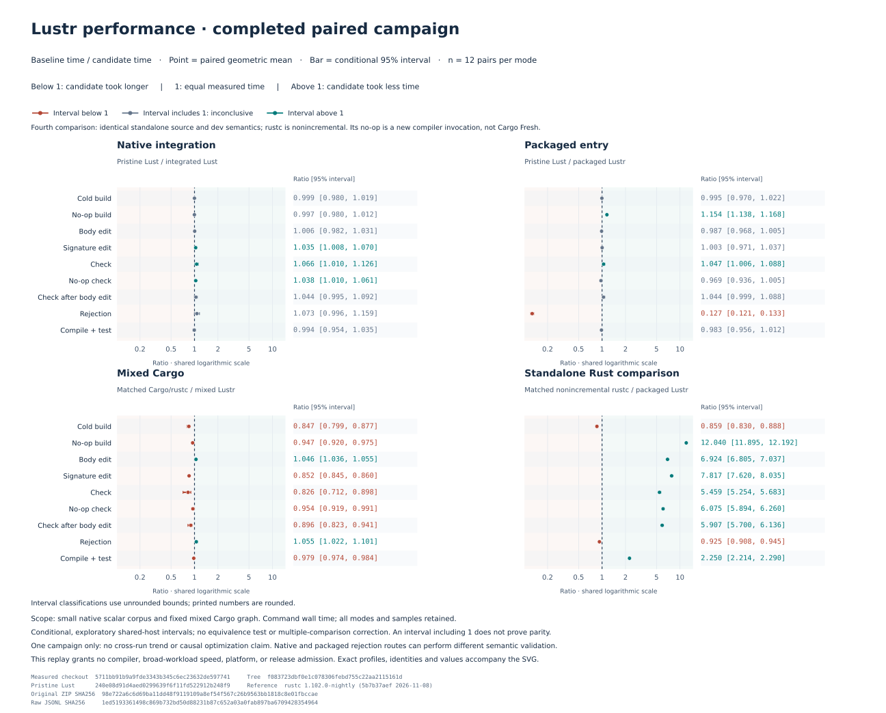

# Lustr performance: complete work and retained evidence

## Status on 17 November 2026

The latest completed paired Cargo campaign records **1.046× faster body-edit
builds [1.036, 1.055]** on the retained scalar fixture, and faster rejection.
Seven other Cargo modes are slower. Lustr is **not yet a generally qualified,
speed-preserving full-Rust compiler**. Cold builds, signature edits, checks,
normal-profile projects and broader native participation remain priorities.
Native warm results against nonincremental standalone rustc do not establish
Cargo acceleration. Upstream Lust's own headline ratios retain their own scope.

The latest complete fixed campaign measures PR13 head
`3e24029f75ee9837f3493be8900f7899e2b52e5f`, actual merge checkout
`5711bb91b9a9fde3343b345c6ec23632de597741`, source tree
`f083723dbf0e1c078306febd755c22aa2115161d`. The package combines
[in-process symbol checks](docs/compiler-set/mixed-symbol-validation.md),
[validated in-process renaming](docs/compiler-set/mixed-symbol-rename.md) and
[direct entry into the Cargo coordinator](docs/compiler-set/cargo-dispatch.md).
It also corrects Cargo command/alias routing. The measurements below cover
the complete combined package. They do not isolate any one optimization.
The preceding `6bf6e3e` campaign on a different runner remains fully archived;
its 1.079× body-edit gain is not the newest paired observation.

In [source-built run 44179667793](https://github.com/glopyglerky/lustr/actions/runs/44179667793/job/134380277750),
target layouts, the unchanged failed-link negative control and recovery, mixed
execution, retained checks with fresh metadata, mixed libraries and all sixteen
entry/runtime tests passed. Original profiling, all 36 fixed comparisons and
the five normal-profile project scenarios also passed. The enclosing job still
**failed** its separate public-slice recorder before collecting timing samples.
The [original failure and correction](performance/slices/2026-11-17-6bf6e3e/README.md)
remain explicit. The corrected recorder subsequently passed on the source-built
PR13 merge checkout in [run 44187580063, job 134408105819](https://github.com/glopyglerky/lustr/actions/runs/44187580063/job/134408105819).
That same fresh job also completed another 648-value paired Cargo/native
campaign and five unchanged-project scenarios. Its byte-identical
[fixed-campaign original archive](performance/archives/2026-11-17-3e24029-qualification.zip),
[complete 36-comparison report](performance/2026-11-17-3e24029.md) and
[four-panel chart](performance/plots/2026-11-17-3e24029/README.md)
are retained and independently replayed. The new unchanged-project
[original public and encrypted ZIPs](performance/projects-pending/2026-11-17-3e24029/README.md)
are also retained, but do not yet have the predecessor campaigns' verified
authenticated private-original recovery.
The [completed public-slice archive](performance/slices/2026-11-17-3e24029/README.md)
independently replays 288 timed observations and 18 comparisons and preserves
all 1,547 original files. It measures actual merge checkout `5711bb9`, tree
`f083723`, **not** the earlier `6bf6e3e` candidate. The PR13 full suite has
not attained all-platform qualification: macOS compatibility was cancelled
before execution, and the independent native Linux gate is separate. A
successful source-built benchmark is not a release gate.

The preceding `5a3f493` source-built job passed its original profile and both
campaigns. The prior `40d2ac3` job failed separate profiling when concurrent
writes joined two trace records. Its paired measurements and project campaign
had passed independently. The [original failure and diagnostic reconstruction](performance/2026-11-17-40d2ac3-profile.md)
remain retained alongside subsequent successful original traces.

The separate full native Linux gates at
[`40d2ac3`](docs/compiler-set/measurements/2026-11-17-native-linux-40d2ac3/README.md)
and [`5a3f493`](docs/compiler-set/measurements/2026-11-17-native-linux-5a3f493/README.md)
each failed after 5,527 ordinary passes and 5,526 sanitized passes, with one
`unicode_props_hash` generated-program execution timeout at the unchanged
ten-second deadline. Linking succeeded; fuzz and benchmark smoke were not
reached. The [bounded local diagnosis](docs/compiler-set/measurements/2026-11-17-unicode-sanitizer-diagnosis/README.md)
encountered a separate LeakSanitizer tracing failure and did not establish the
hosted timeout's cause. The current run uses two workers while preserving cases,
sanitizers and deadlines; a pending run supplies no passing gate.

Earlier complete Linux gates at
[`dec0ce2`](docs/compiler-set/measurements/2026-11-17-native-linux-dec0ce2/README.md)
and [`74e14e7`](docs/compiler-set/measurements/2026-11-17-native-linux-74e14e7/README.md)
remain attributed to their exact sources. Cross-target layout checks and
Rust/Cargo corpus checks do not establish native execution on other platforms.
Earlier macOS failures and [portable fixture/Unix-address corrections](docs/compiler-set/native-differential-portability.md)
remain preserved; recent cancellations establish no native macOS qualification.

## Which work is being compared?

| Workload | Reference and candidate | Evidence and boundary |
| --- | --- | --- |
| Fixed real Cargo graph | Matching Cargo/rustc → mixed Lustr | Real procedural macro, async code and a no_std/alloc dependency, with native objects and complete Rust compilation; explicit dev debug=0. |
| Actual unchanged coordinator package | Matching Cargo/rustc → primary Lustr entry | Five scenarios under normal dev/test defaults, including debug=2; outside native-object eligibility. Forced rebuilds change timestamps, not source bytes. |
| Historical unchanged Lust compiler project | Cargo/LLVM → explicit coordinator/Cranelift | November 8 whole-project builds with an older SDK and custom unwind-enabled backend; two measured pairs, no current mixed-compiler claim. |
| Supported native scalar corpus | Pristine Lust → integrated Lust | Preservation check for the declared native integration. |
| Same native corpus | Pristine Lust → packaged Lustr entry | Includes entry routing; rejection can add full-Rust validation. |
| Same native corpus | Matching standalone rustc → packaged native entry | Identical source and explicit dev semantics; rustc is nonincremental. First measured in schema 2 at `5a3f493`. |
| Pruned public upstream goport-util-small slice | Pristine Lust, integrated Lust, packaged standalone entry and matched incremental Cargo | Twelve matched pairs for cold/no-op check, build and run; no source edits or mixed Cargo route. Fresh successful archive at `3e24029`. |
| Larger native workspaces, broad edit families, startup/restart, isolated runtime and resources | Separate campaigns | Not established by these tables or a one-repetition CI smoke check. |

The fixed native corpus and Cargo graph are small. Older
[native product experiments](docs/compiler-set/measurements/2026-11-15-native-inference-v34/README.md)
have different architectures, producer-version confounds and retained limits.
They remain separate from current-entry measurements. The
[upstream audit](docs/compiler-set/upstream-benchmark-audit.md) maps Lust's
actual studies against this coverage.

## Latest fixed-corpus results

Twelve matched pairs per mode, Linux x86-64, PR13 head `3e24029` and actual
merge checkout `5711bb9`. Times are
milliseconds. The ratio is the geometric mean of **baseline time divided by
candidate time**, with a conditional paired-bootstrap 95% interval. Below one
means the candidate took longer. It is not the ratio of the displayed medians.

### Mixed Cargo graph

Both lanes execute Cargo on the same source and dependency graph with the
matching SDK. The candidate can reuse checked scalar bodies and native objects;
the full Rust compiler still provides valid metadata and unsupported semantics.
The fixture's dev profile explicitly uses debug=0. It is neither a default-profile
large-project result nor a comparison with standalone Lust replacing real
Cargo dependency crates.

| Cargo workload | Cargo/rustc median | Mixed Lustr median | Ratio [95% interval] |
| --- | ---: | ---: | --- |
| Cold build | 168.135 | 194.613 | 0.847 [0.799, 0.877] |
| No-op build | 10.109 | 10.730 | 0.947 [0.920, 0.975] |
| Body edit | 55.296 | 53.101 | 1.046 [1.036, 1.055] |
| Signature edit | 59.561 | 69.471 | 0.852 [0.845, 0.860] |
| Check | 46.012 | 51.969 | 0.826 [0.712, 0.898] |
| No-op check | 10.272 | 10.800 | 0.954 [0.919, 0.991] |
| Check after body edit | 28.767 | 30.800 | 0.896 [0.823, 0.941] |
| Rejection | 39.364 | 37.976 | 1.055 [1.022, 1.101] |
| Compile plus test | 82.475 | 84.234 | 0.979 [0.974, 0.984] |

The body-edit build takes **4.0% less median time**, with a paired estimate of
**1.046× [1.036, 1.055]** against matching Cargo/rustc. Rejection also favors
Lustr. Seven other modes remain slower: cold builds take about **16% longer**,
signature edits **17% longer**, and checks **13% longer** by the medians.
This is a narrow Cargo improvement on the retained scalar-body fixture, not
general Cargo acceleration. No historical sample was removed or replaced.

[All 36 comparisons and p95s](performance/2026-11-17-3e24029.md),
[all 648 timed values](performance/2026-11-17-3e24029.csv), and the
[vector chart with exact source data](performance/plots/2026-11-17-3e24029/README.md)
are retained. No average across unrelated modes serves as a headline.



The nine campaigns' mixed cold/body/signature ratios are respectively
0.726/0.596/0.552, 0.662/0.581/0.558, 0.732/0.601/0.554,
0.717/0.614/0.553, 0.756/0.612/0.547, 0.743/0.622/0.558 and
0.773/0.624/0.548, followed by 0.862/1.079/0.857 and
0.847/1.046/0.852. Different source revisions and uncontrolled shared-host
conditions prevent a causal cross-run improvement claim. The earlier `afb17a8`
cold candidate outlier of 1,026.532 ms remains in its original samples; no
slower observation was excluded to obtain the published results.

## Actual project under its normal defaults

The [latest verified coordinator campaign](performance/projects/2026-11-17-6bf6e3e/README.md)
uses the unchanged actual `crates/lustr` package, its library, executables,
integration tests and existing fixture builds. Both lanes retain normal dev/test
profiles, debug=2, features and panic behavior. This profile falls outside
native-object eligibility; these results measure compatibility and overhead.

| Project scenario | Matched Rust median (ms) | Lustr median (ms) | Ratio [95% interval] |
| --- | ---: | ---: | --- |
| Clean dependency build | 495.682 | 500.290 | 0.9905 [0.9836, 0.9973] |
| Primed root build | 146.147 | 147.562 | 0.9932 [0.9777, 1.0083] |
| Primed root check | 47.891 | 49.520 | 0.9672 [0.9547, 0.9808] |
| No-op build | 8.872 | 9.904 | 0.9130 [0.8930, 0.9393] |
| Compile plus test | 4583.380 | 4653.394 | 0.9832 [0.9793, 0.9879] |

Four intervals favor matched Rust; primed root build is inconclusive. Median
overhead is about 0.9% for clean build, 1.0% for primed root build, 3.4% for
primed check, 11.6% for no-op and 1.5% for compile plus test. These descriptive
percentages use the displayed medians, without a pooled estimator. The
[preceding project campaign](performance/projects/2026-11-17-5a3f493/README.md)
and its predecessor retain their original values. Changes across hosts and
revisions do not establish a causal optimization effect.

The forced build, check and compile-plus-test scenarios change only a source
timestamp. Source bytes stay unchanged. These are root rebuilds and do not
measure body/signature edits or demonstrate native acceleration. The project
has no registry dependencies.
Cold state clearing leaves OS page caches and dependency sources warm.
Each scenario contains twelve measured pairs after two excluded warmup pairs.
Both lanes pass initial/final executing tests and structured E0502 rejection
gates. The test gate reports 40 passed and nine existing explicitly ignored
tests. Source/tool guards, command contracts, Cargo fingerprints, owned state
transitions and observed successful daemon shutdown are required. Shutdown
receipts observe zero native child exits and do not claim native work.

Each original campaign contains 120 measured values plus warmups and gates.
The three campaigns retain **360 timings and fifteen comparisons**, separately from
the fixed-corpus totals. Their public projections contain every timing, pair
order, original stream hash, host snapshot and gate count. They do not expose
private original command streams or environments.

## Historical full-project Cargo acceleration with Cranelift

The [November 8 whole-project experiment at `42ab5dc`](docs/compiler-set/verification.md#qualified-full-project-result)
compiled the unchanged upstream Lust compiler's `lust` and `lust-core` binaries
through real Cargo. Both lanes used their project's default dev profile and
the same pinned `nightly-2026-11-05` SDK. The candidate explicitly selected
custom Cranelift revision `8edf4d040acb77048e04b52a379e93dccae888e6`, built with
its `unwinding` feature, while the reference used LLVM.

| Historical Cargo scenario | LLVM median | Cranelift median | Ratio of medians, LLVM / Cranelift |
| --- | ---: | ---: | ---: |
| Empty target directory | 59.536 s | 39.400 s | 1.511 |
| Warm, no source change | 19.532 ms | 21.149 ms | 0.924 |

There were only two measured pairs per scenario. The cold result represents
33.8% less median build time for that configuration; no-op builds were slower.
These descriptive ratios do not use the current paired geometric estimator and
have no confidence interval. The full build timings exclude runtime probes,
unit tests, verification and setup. Both lanes passed the same 391 unit tests
and runtime/rejection probes; the recorded compiler commands verify the backend.
The legacy project's pinned Cargo layout adjustment and test-only stack setting
were applied equally to both lanes and remain part of its qualification scope.

The [summary and identities](docs/compiler-set/evidence/lust-project-42ab5dc-summary.json),
[complete compressed report](docs/compiler-set/evidence/lust-project-42ab5dc.json.gz)
and [backend provenance](docs/compiler-set/evidence/lust-project-42ab5dc-backend.json)
retain the original evidence. This is an opt-in compatibility-coordinator path,
not the current mixed native compiler or an automatically selected backend.
Its rustc source `2d20b42b883dcfc014f3c2c56081eeb6091c2179` differs from the
current campaign SDK. The stock rustup Cranelift preview failed panic recovery;
the [matching custom backend requirement](crates/lustr/README.md#try-the-complementary-development-backend)
cannot be replaced by a panic flag or an arbitrary installed backend. Requalify
the complete current package and measure it before claiming a present Cargo gain.

## Native entry versus pristine Lust and matching rustc

This is the same completed `3e24029` campaign and twelve matched pairs per mode
as the mixed Cargo table. Times are median milliseconds and ratios use the
paired geometric estimator, distinct from the historical Cranelift medians.

| Native workload | Pristine Lust median | Standalone rustc median | Lustr median | rustc / Lustr ratio [95% interval] |
| --- | ---: | ---: | ---: | --- |
| Cold build | 48.204 | 41.666 | 47.016 | 0.859 [0.830, 0.888] |
| No-op build | 4.070 | 42.418 | 3.525 | 12.040 [11.895, 12.192] |
| Body edit | 5.961 | 41.854 | 6.033 | 6.924 [6.805, 7.037] |
| Signature edit | 5.333 | 41.810 | 5.396 | 7.817 [7.620, 8.035] |
| Check | 2.435 | 12.856 | 2.449 | 5.459 [5.254, 5.683] |
| No-op check | 2.067 | 12.719 | 2.120 | 6.075 [5.894, 6.260] |
| Check after body edit | 2.272 | 12.817 | 2.174 | 5.907 [5.700, 6.136] |
| Rejection | 2.650 | 19.314 | 20.810 | 0.925 [0.908, 0.945] |
| Compile plus test | 26.053 | 59.128 | 26.322 | 2.250 [2.214, 2.290] |

Seven native comparisons favor Lustr over this standalone rustc configuration;
cold and rejection favor rustc. Body edits are 6.924× and signature edits
7.817× faster by the paired estimate. Native no-op is 12.040× faster, with
3.525 ms versus 42.418 ms medians. **Every rustc no-op starts a nonincremental
compiler invocation.** This is not Cargo's cached no-op or a comparison against
the fastest possible rustc configuration.

The [exact reference contract](docs/compiler-set/native-rustc-comparison.md)
uses identical supported source and edition 2024, target x86_64 Linux, opt-level
0, debug 0, unwind, overflow checks and debug assertions. Build emits a linked
program; check emits metadata. Rust compile-plus-test includes `rustc --test`,
actual execution with one test thread, and the adapter process's overhead.
Both child commands and exit/signal receipts are retained. Passing/failing
tests, invalid-source rejection, accepted runtime and recovery are required.

Against pristine Lust, native cold, body edits and compile-plus-test are
inconclusive. Native no-op favors Lustr at 1.092 [1.070, 1.113], signature edit
at 1.045 [1.010, 1.078], and check at 1.046 [1.008, 1.081]. Packaged rejection
is slower at 0.122 [0.113, 0.132]; the entry may perform full-Rust validation
after native rejection. The full language and diagnostic contract remains
part of that measured cost.

The pristine→integrated comparison has three intervals favoring the candidate
(signature edit, check, no-op check) and six inconclusive intervals. An
inconclusive interval does not prove equivalence; classification uses unrounded
bounds. Packaged rejection takes 20.810 ms versus pristine Lust's 2.650 ms
and standalone rustc's 19.314 ms.
Returning the first native error could incorrectly reject valid full Rust.
This complete user-visible negative path performs differing semantic work.

## Exact source, retention and replay

All nine fixed campaigns use pristine Lust revision
`240e08d91d4aed0299639f6f11fd522912b248f9`, tree
`0ab1b09815802894e6078de0af59273cbdf46cb0`. The matching imported Rust SDK is
rustc 1.102.0-nightly, commit `5b7b37aefcb5b2fba3c2392bc9065b9e4602d494`,
commit date 2026-11-08, host x86_64-unknown-linux-gnu, LLVM 23.1.5.
The native correctness gate uses a separate Rust 1.99.0 oracle.

| Candidate / schema | Actual measured checkout | Repository tree | Host / profile availability |
| --- | --- | --- | --- |
| `c70eb1c` / 1 | `e7e9cf2a224b2590b895298439e5ede814c6229b` | `bf575b9343774b50646a78a5aa22eb52960de840` | Neither recorded |
| `afb17a8` / 1 | `bc5e0f9cd1168b6b064b9cda9a1455f4fc97d143` | `3ccebbefb604e0c45715200bcabc3b32b182d3ef` | Neither recorded |
| `048d824` / 1 | `fe4704ec6951b8c22c003476886602368810f637` | `5aec709fcd0df39004973a33320492ba82eb4fc1` | Neither recorded |
| `dec0ce2` / 1 | `dbacce1d14c8df60427eeca8dc7865156c98dcb4` | `c29f3bda282c0870c163303d865abb9be81bd066` | Host; completed v1 profile |
| `74e14e7` / 1 | `d0caf843d519763ae3b7bc8a3fdd1c26b12b307d` | `c15cdcb3481f2ee34651a8aa6c901d24df05ff8f` | Neither recorded |
| `40d2ac3` / 1 | `3b4b0bd67401085129d26be1afbd20e96c9b9d02` | `78318c4b01f8eb6f9518ea331efe69f0c457b1ce` | Host; failed v2 original, separate diagnostic reconstruction |
| `5a3f493` / 2 | `b3393a4a2907228516546cd34f1a5c60aaf6aaaa` | `2fca60e57829890b10a4a23da57bafab2581b092` | Host; completed original v2 profile |
| `6bf6e3e` / 2 | `5a3c5666a16d46629a4787e37ca9b20e65720ccc` | `02652f033e84c0957dd2b99eb562db8171289e50` | Host; completed profile with in-process symbol validation |
| `3e24029` / 2 | `5711bb91b9a9fde3343b345c6ec23632de597741` | `f083723dbf0e1c078306febd755c22aa2115161d` | Host; completed source-built mixed, profile and public slice |

The preceding `6bf6e3e` checkout has an
[incremental source bundle](performance/sources/2026-11-17-6bf6e3e/README.md)
preserving that exact object and declaring both prerequisites. An isolated restore
reproduced the tree and all recorded source-entry names, modes and blob IDs.
That inventory check does not freshly hash every blob or recover compiler
binaries. The newer `3e24029` measurement retains its original complete
qualification ZIP and source identity; a separate source-recovery bundle has
not been published for that checkout. [campaigns.json](performance/campaigns.json) records every full head,
run/artifact ID and original/derived digest.

The latest [original qualification artifact](https://github.com/glopyglerky/lustr/actions/runs/44187580063/artifacts/14378182184)
has ZIP SHA-256
`98e722a6c6d69ba11dd48f9119109a8ef54f567c26b9563bb1818c8e01fbccae`;
its original raw JSONL SHA-256 is
`1ed5193361498c869b732bd50d88231b87c652a03a0fab897ba6709428354964`.

Nine byte-identical original fixed-fixture ZIPs preserve **5,184 timed values,
270 comparisons and 17,088 command-output files** beyond Actions expiry. They
contain exact commands, exits, stdout/stderr, source/build receipts, component
hashes, correctness outputs, cache probes, host/profile records where collected,
and original failures. They do not contain every compiler binary. CSVs and
tables are derived projections. CI replays each archive and verifies exact
published table bytes; older artifacts are not overwritten.

Actual-project evidence has a separate publication boundary. Each campaign's
six public files and original public/encrypted ZIPs are retained byte for byte.
Authenticated recovery and source-bound reconciliation passed for **600 private
original files and 510 streams in each campaign**. The original private plaintext and
key remain private. Public CI checks file inventories, original ZIP digests,
ciphertext bindings, all 360 measured values and fifteen statistical comparisons.

[Recovery receipts](performance/projects/2026-11-17-6bf6e3e/recovery/result.json)
distinguish the locally rebuilt existing replay from the unavailable original
CI binaries. The recorded-source exporter reproduces public samples and README
byte for byte; other projection receipts agree semantically. Original compiler,
runtime, constructor and runner binaries are not freshly requalified. Exporter
runtime identity was not recorded by campaign version 1 and remains null.
Public replay does not perform another decryption or compiler execution.

## Work and statistical protocol

Compiler components use their manifest release profiles. Fixed-fixture
applications use dev opt-level 0, debug 0 and normal unwind/checks. The matched
SDK and identical paired inputs remain part of each recording. The actual
project keeps its separate normal debug=2 dev/test profile.

Schema 2 has four native lanes and two Cargo lanes, nine modes and twelve
measured observations per lane/mode: **648 timed commands and 36 summaries**.
Its original record contains 1,135 raw records, including 1,080 timed/untimed
commands and 2,160 output files. The six schema-1 campaigns remain five-lane,
540-command, 27-summary recordings, each with 938 raw records, 884 commands
and 1,768 outputs. Untimed priming, correctness, lockfile work and probes remain
in the archives without becoming timing samples. The different contrasts reuse
some measured lanes; the displayed comparisons are not independent experiments.

Native retention probes are separate untimed checks. A
`bodies-without-body-work` route requires zero relevant checked-body/codegen
counters; it does not mean zero total work. Earlier pristine traces still
performed collection, distinct from an explicit `reuse` route.

Cold trials use fresh per-pair Cargo target, intermediate, mixed, native and
XDG runtime cache directories. Native cold disables daemon/disk compiler
caches. OS page caches are not flushed. Warm trials retain each lane's native
daemon and caches. Matching standalone rustc remains nonincremental and starts
a compiler process on every request. A Cargo no-op may not invoke a compiler.
These are declared tool behaviors, not equivalent cache implementations.

The recorder uses randomized cyclic lane order, seed `327849038930`. Schema 2
accepts pair counts that are multiples of four from twelve through ninety-six,
so complete cyclic blocks cover all four native lanes. It measures command
wall time through observed child exit, with 100-microsecond polling. Tracing
and compiler statistics are disabled for measured commands. Runtime assertions
after ordinary builds are outside compile-only timing; compile-plus-test
includes actual execution. It is not an isolated runtime-throughput benchmark.

For matched times `(a_i, b_i)`, the estimate is
`exp(mean(log(a_i) - log(b_i)))`. The existing statistics implementation uses
10,000 paired bootstrap resamples, SplitMix64 with rejection-index sampling,
and percentile intervals. Sign-flip calculation is exact for the recorded
twelve-pair campaigns and through sixteen pairs; it is unavailable above
sixteen. The replay checks this existing implementation, not a replacement
estimator. The p95 is nearest rank; with twelve samples it equals the sample
maximum and is descriptive rather than a strong tail guarantee.

Intervals are exploratory and conditional on the workload and sampling setup.
Shared-host/cache effects can compromise bootstrap independence and sign-flip
exchangeability. There is no multiple-comparison correction or predeclared
equivalence margin. An interval containing one is inconclusive. An interval
excluding one does not establish universal performance or release admission.
Absolute observations, paired results and every slower sample remain visible.

## Reproduce the evidence

Fixed-fixture reporting uses Python 3.10 or newer and the standard library:

```sh
python3 tools/test-mixed-performance-report.py
python3 tools/check-mixed-performance-tables.py
python3 tools/check-mixed-performance-archives.py
python3 tools/report-mixed-performance.py \
  performance/archives/2026-11-17-6bf6e3e-qualification.zip \
  --output /absolute/new-report-directory
```

The output directory must not exist. Validation finishes before publication;
no recorded command arguments are executed. Outputs are `README.md`,
`timings.csv` and a fuller derived `samples.json` with identities and original
summaries. ZIP input binds its archive digest; an extracted directory cannot
claim a ZIP hash. All eight original CSV/Markdown reports replay byte for byte.

Verification covers completed status, raw digest, matching records, all output
sizes/hashes, source stability, identical paired inputs, exact schema coverage,
unique sample IDs, expected exits, no timeout/signal, balanced order, retention
probes and statistical replay. Both schemas bind timed Cargo commands to the
exact lane executable, operation/flags, source inventory, working directory and
owned target/intermediate directories. Compile-plus-test requires one executed
passing scalar-contract test. The current verifier closes two historical gaps:
executable relabeling and compiled-but-unexecuted tests. Original recordings
already performed the required work and replay unchanged.

Schema 2 additionally binds native executable, source, operation and flags,
including the two-child standalone rustc test receipts. That stronger native
argument contract does not retroactively extend to schema-1 native commands or
every older untimed probe. Altered executable identities, missing comparisons
and omitted test execution fail verification.

All 80 reporting regressions passed. Archive/table replay now covers 270 summaries,
5,184 timing values and 17,088 output files. These checks validate evidence;
they do not rerun the measured compilers. Original correctness gates supply
their separate executed evidence.

For public project replay, with the matching SDK installed:

```bash
cargo +nightly-2026-11-09 build --manifest-path crates/lustr-bench/Cargo.toml \
  --release --locked --example replay --target-dir target/project-replay
python3 tools/check-coordinator-performance-archives.py \
  --replay target/project-replay/release/examples/replay
```

Private recovery additionally requires the authorized recipient key, authenticated
decryption, archive verification before extraction, exact ordinary-file modes
and the recorded Git source. The [recovery procedure](docs/compiler-set/coordinator-performance.md)
and per-campaign receipts distinguish that operation from public replay.

To execute another actual campaign, use the exact source and
[source-built workflow](.github/workflows/compiler-set.yml) or
[build-and-qualify instructions](docs/compiler-set/mixed-compiler.md#build-and-qualify).
Build matching pristine, integrated and packaged components with the pinned
SDK/TinyCC, run every correctness prerequisite, then the existing recorder.
Keep all modes and original outcomes; a historical or unmatched package is
not a newly qualified candidate. Profiling runs separately from paired timing.
New completed artifacts receive new files and manifest entries.

## Host and measurement limits

The latest `3e24029` fixed campaign records AMD EPYC 9V74 80-Core Processor,
four visible logical CPUs and observed affinity 0–3, 16,760,340,480 bytes of
physical memory, Linux 7.0.0-1017-azure and Ubuntu image 20261111.370.1.
CPU quota, memory limit and frequency governors are unreported. The project
has its own before-campaign snapshot from the same job. Only `dec0ce2`,
`40d2ac3`, `5a3f493`, `6bf6e3e` and `3e24029` have fixed host snapshots;
missing facts in the other four campaigns remain unknown.
Matching model/image descriptions do not establish controlled physical-host
or load equivalence between jobs.

The host collector binds its exact bytes and parsed facts to campaign identities.
These are observations: affinity is not pinned, physical memory is not a process
budget, and load/frequency can change. CPU time, RSS, aggregate process memory,
daemon growth, energy and isolated application runtime are unmeasured. Twelve
observations do not support broad tail-latency claims. Upstream Lust's reported
hardware and corpus facts are not substituted for Lustr's missing measurements.

## Phase attribution and retained history

The [latest original phase report](performance/2026-11-17-3e24029-profile.md)
was retained from the completed `3e24029` archive. Its body-edit command
records 2.420 ms native daemon roundtrip, including 0.014 ms symbol validation,
0.011 ms renaming, and 18.261 ms for the original linker. The profile spans
are separate from paired timing samples, and cross-host differences are not a
causal optimization estimate.

The [preceding original profile](performance/2026-11-17-6bf6e3e-profile.md) passes
strict replay with in-process symbol validation. Its body-edit observation
records 1.821 ms for the native request, 0.008261 ms for symbol validation,
0.043122 ms for symbol renaming and 15.320 ms for the original linker. The
remaining cold/signature/check costs require full-work profiling; an eliminated
process does not eliminate Rust analysis, metadata, invalidation or linking.
See the full profile for all commands, nested spans and exact identities.

The historical profile below records the predecessor's observed bottleneck.
Differences between instrumented runs are not a controlled causal estimator.

The [preceding original v2 qualification](performance/2026-11-17-5a3f493-profile.md)
passed with 26 compiler profiles, 15 qualification commands and 35 successful
native responses containing measured emitter detail. Its 132 original input
files remain in the qualification ZIP. The original summary and Markdown
reproduce byte for byte, without reconstructing a trace or weakening validation.

Profiling is separate under `LUSTR_MIXED_PROFILE_DIR`; paired commands clear
their environments and do not inherit it. Spans can nest and compiler processes
can overlap. Summing spans does not produce command wall time. The following
values are instrumented observations, not additional paired speed samples.

| Instrumented duration (ms) | Body: one request | Signature: five requests summed |
| --- | ---: | ---: |
| Complete native request | 37.680779 | 176.700542 |
| Client request setup | 0.119698 | 0.377320 |
| Protocol exchange | 37.551081 | 176.282993 |
| Remote emitter | 35.257744 | 162.980178 |
| libtcc | 0.197719 | 2.016269 |
| Symbol-inspection process call (`nm`) | 34.545005 | 158.645402 |
| Native-object file synchronization | 0.409056 | 1.888154 |
| Directory synchronization | 0.009334 | 0.038698 |
| Exchange outside emitter, unattributed | 2.293337 | 13.302815 |

Remote emitter durations retain their own clock domain. The outside-emitter
residual includes transport, queueing, native frontend work before emission,
retained-state work afterward, guards and response production; it is not a
measured frontend phase. Signature values sum five requests and must not be
compared directly with the command's wall duration.

Across all 35 successful responses, the complete `nm` process-call span ranges
from 30.808 to 34.545 ms, median 31.857 ms. It includes lookup, launch, execution,
output capture and waiting. The actual child binary identity, emitted object
bytes and child CPU/spawn breakdown are absent. This is a dominant observed
span whose cause remains unresolved. Explaining that historical delay requires
same-runner tool and object identity plus spawn/wait attribution. The measured `6bf6e3e` package removes this subprocess through checked
in-process object validation; its complete-command measurements appear above. Undefined-symbol validation and durable object/certificate
synchronization remain required.

The [completed v1 profile](performance/2026-11-17-dec0ce2-profile.md) and the
[later failed v2 original with separate reconstruction](performance/2026-11-17-40d2ac3-profile.md)
keep their original status. The writer correction constructs a complete record
and holds the append-file lock through all writes. Its concurrent-process test
fails the predecessor and passes the correction; the new hosted profile now
validates that correction in the source-built toolchain. All 26 strict profiler
tests pass. Failed native responses keep their original diagnostic bytes so
the daemon's fresh/warm comparison preserves its meaning.

The [24-pair temporary-copy experiment](performance/components/2026-11-17-40d2ac3-link-input/review.md)
is a component result, outside compiler timing totals. Disposable copies omit
synchronization, while durable retained objects and certificates keep it.
The experiment neither measures a complete link nor establishes an additional
merge gain; the preceding candidate already omitted disposable-copy synchronization.

## Remaining performance work

The [upstream audit](docs/compiler-set/upstream-benchmark-audit.md) identifies
larger native workspaces, wider edit families, accepted/rejected recovery timing,
daemon startup/cached restart, release compilation, isolated application runtime
and CPU/memory studies. The direct same-source native/rustc comparison is now
measured. The unchanged coordinator adds real-project compatibility and overhead
coverage; its default profile does not establish large native acceleration.

The performance priority is complete Cargo work: cold builds, source body and
signature edits, checks and executing tests. The in-process symbol
validator, renaming and direct Cargo entry have now passed complete source-built
correctness and paired measurements together. The next work is to reduce the
remaining cold, signature and check costs, and expand to unchanged projects with
real source edits and observed native participation. Keep default-profile
fallback and no-op overhead visible; debug=2 linked generation remains outside
native-object eligibility.
The full native sanitizer runtime failure and native macOS execution remain
separate correctness requirements.
An optimization must preserve checked Rust objects, retained native state,
real metadata, invalidation, diagnostics, panic behavior and complete work.
Retain its predecessor, exact sources, correctness results and all slower
observations, then rerun the complete paired campaign. Cross-run changes alone
do not isolate the optimization's effect.

The recovered [public upstream slice runner](docs/compiler-set/upstream-slice-benchmark.md)
adds supported-native scale, explicit incremental Cargo, no-op and generated
program execution scenarios. It uses upstream's pruned source and dependency
stand-ins. It does not measure source edits or run the mixed compiler through
Cargo. Its first hosted attempt failed before timing because daemon statistics
were not enabled; the original zero-sample failure remains retained. The
corrected fresh hosted run **completed** with original evidence replayed:

| Public slice scenario | Cargo/rustc median | Standalone Lustr entry median | Ratio [95% interval] |
| --- | ---: | ---: | --- |
| Cold check | 290.058 | 192.505 | 1.516 [1.475, 1.571] |
| No-op check | 10.409 | 35.689 | 0.293 [0.288, 0.298] |
| Cold build | 391.988 | 348.570 | 1.153 [1.100, 1.231] |
| No-op build | 10.669 | 38.231 | 0.283 [0.278, 0.288] |
| Compile plus run | 11.521 | 39.771 | 0.294 [0.287, 0.302] |
| Runtime only | 0.800 | 1.099 | 0.742 [0.709, 0.780] |

All times are median milliseconds, ratio is paired geometric mean, and
intervals are exploratory. Pristine Lust's no-op check median was 1.565 ms
on this fixture, exposing substantial entry overhead. `src/full.rs::select`
invokes Cargo metadata for each explicit source/manifest selection, but that
phase has **not** been isolated and cannot yet be assigned the full overhead.
The [source-bound archive, provenance and full 18-comparison table](performance/slices/2026-11-17-3e24029/README.md)
preserve slower observations. These results do not replace the separate
mixed-Cargo body-edit measurement, prove general Cargo acceleration or benchmark
the full unchanged ts-rust project.

Broader mixed coverage, representative workload speed and release admission
remain open. [Older work and the Darwin loader/lifetime investigation](docs/compiler-set/retained-work-disposition.md)
retain their own scope. Source identity, successful replay and a green
measurement step cannot substitute for those requirements.
