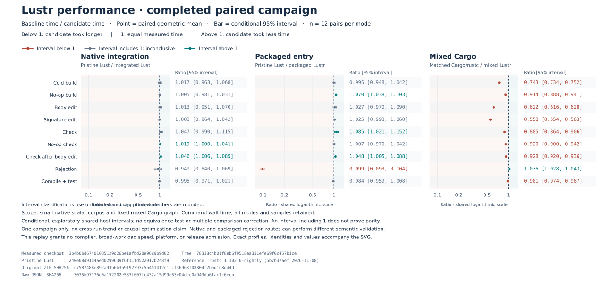

# Lustr performance: complete work and retained evidence

## Status on 17 November 2026

Lustr is **not yet a generally qualified, speed-preserving full-Rust compiler**.
The qualified mixed Cargo graph executes correctly, but its compilation has
material overhead. A completed measurement campaign does not mean Lustr won.
Upstream Lust's headline speedups are not measurements of this integration.

The latest retained fixed campaign measures PR11 head
`40d2ac3f0b71abaa1e73cd366d8c43f8eb4d4581`. In
[run 44096292176](https://github.com/glopyglerky/lustr/actions/runs/44096292176/job/134084163908),
the source-built compiler passed target layouts, the unchanged failed-link
negative control and corrected recovery, mixed execution, retained checking
with fresh Rust metadata, mixed libraries, and all fifteen entry/runtime tests.
Both the fixed paired campaign and the unchanged-project campaign passed.

The source-built job nevertheless **failed its separate profiling validation**:
concurrent processes joined two independent trace records. All corresponding
compiler profiles exist. The [diagnosis and correction](performance/2026-11-17-40d2ac3-profile.md)
retain the original failure and a separately labeled reconstruction. The fixed
writer passes the same concurrent-process test that fails against its predecessor;
fresh source-built execution is still required to qualify that correction.
Seven other non-macOS jobs passed. The macOS compatibility job was cancelled
without executing any steps because GitHub could not acquire hosted ARM64
capacity; a retry does not count as execution before it runs.

The earlier [complete Linux native gate at dec0ce2](docs/compiler-set/measurements/2026-11-17-native-linux-dec0ce2/README.md)
passed 5,527 differential checks and the same case set with sanitizer-configured
generated C, plus later native suites. The concurrently updated
[base at 74e14e7](docs/compiler-set/measurements/2026-11-17-native-linux-74e14e7/README.md)
also passed its older 5,526-case Linux gate. Default macro-corpus and kernel
checks are Rust/Cargo reference checks, not native Lust coverage. The combined
40d native gate has its own [run](https://github.com/glopyglerky/lustr/actions/runs/44096292187).
Its result must be assessed on that exact source. Latest native macOS attempts
were cancelled before execution; the earlier four executed failures and their
[portable-fixture/Unix-bound correction](docs/compiler-set/native-differential-portability.md)
remain recorded. Linux and cross-target layout results do not establish native
macOS execution or all-platform admission.

## Which work is being compared?

| Workload | References and candidate | Evidence and boundary |
| --- | --- | --- |
| Supported native scalar corpus | Pristine Lust → integrated Lust | Direct preservation check for the declared native integration. |
| Same native corpus | Pristine Lust → packaged Lustr entry | Includes routing and request handling; rejection may require additional full-Rust validation. |
| Fixed real Cargo graph | Matched Cargo/rustc → mixed Lustr | Real proc macro, async code and a no_std/alloc dependency, with native objects and complete Rust compilation. |
| Same supported native corpus | Matched standalone rustc → packaged native entry | Not measured by the six schema-1 campaigns. A new reference lane is being qualified separately; no cross-corpus ratio fills this cell. |
| Unchanged coordinator package | Matched Cargo/rustc → primary Lustr entry | Five completed scenarios with normal dev/test defaults, including debug=2; outside current mixed-object eligibility. |
| Daemon startup/cached restart, broad edit families, larger native projects, runtime/resources | Separate required campaigns | Not established by these complete-work timing tables or CI's one-repetition smoke. |

The native corpus and fixed Cargo graph are small. Historical
[native product experiments](docs/compiler-set/measurements/2026-11-15-native-inference-v34/README.md)
include older direct product/Lust/stock comparisons, with different architecture,
producer-version confounds and retained limits. They are not current-entry
measurements. The [upstream audit](docs/compiler-set/upstream-benchmark-audit.md)
maps Lust's actual studies and their scope against this coverage.

## Latest fixed-corpus results

Twelve matched pairs per mode, Linux x86-64, head `40d2ac3`. Times are milliseconds.
The ratio is the geometric mean of **baseline time divided by candidate time**,
with a conditional paired bootstrap 95% interval. Below one means the candidate
took longer. This is not the ratio of the displayed medians.

| Cargo workload | Cargo/rustc median | Mixed Lustr median | Ratio [95% interval] |
| --- | ---: | ---: | --- |
| Cold build | 145.655 | 197.386 | 0.743 [0.734, 0.752] |
| No-op build | 8.664 | 9.557 | 0.914 [0.888, 0.941] |
| Body edit | 46.737 | 75.151 | 0.622 [0.616, 0.628] |
| Signature edit | 49.842 | 89.481 | 0.558 [0.554, 0.563] |
| Check | 39.102 | 43.810 | 0.885 [0.864, 0.906] |
| No-op check | 8.621 | 9.411 | 0.920 [0.900, 0.942] |
| Check after body edit | 23.264 | 24.940 | 0.928 [0.920, 0.936] |
| Rejection | 32.086 | 30.935 | 1.036 [1.028, 1.043] |
| Compile plus test | 71.230 | 72.311 | 0.981 [0.974, 0.987] |

By the displayed medians, cold builds take approximately 36% longer, body edits
61% longer and signature edits 80% longer. Eight mixed modes are slower in this
campaign; the faster rejection result does not offset them. The earlier `afb17a8`
cold candidate outlier of 1,026.532 ms remains in its original samples.

For the native entry, cold and body editing are inconclusive at
0.995 [0.948, 1.042] and 1.027 [0.970, 1.090]. No-op is faster on this corpus at
1.070 [1.038, 1.103]: 3.138 ms for pristine Lust and 2.947 ms for the entry.
Compile plus test is inconclusive at 0.984 [0.959, 1.008], after the preceding
`dec0ce2` campaign recorded a slowdown. An inconclusive interval does not prove
parity; classification uses unrounded bounds.

Packaged rejection is much slower: 1.759 ms versus 18.025 ms,
0.099 [0.093, 0.104]. The entry may invoke full-Rust validation and diagnostics
after native rejection. Returning the first native error could reject valid
full Rust and is not a valid optimization. This is an end-user negative-path
cost, not a claim that equivalent frontend phases became ten times slower.

[All 27 comparisons and p95s](performance/2026-11-17-40d2ac3.md),
[all 540 timed values](performance/2026-11-17-40d2ac3.csv), and
[the vector chart with source data](performance/plots/2026-11-17-40d2ac3/README.md)
are retained. No average across unrelated modes is used as a headline.



The six campaigns' mixed cold/body/signature ratios are respectively
0.726/0.596/0.552, 0.662/0.581/0.558, 0.732/0.601/0.554,
0.717/0.614/0.553, 0.756/0.612/0.547 and 0.743/0.622/0.558.
Source revisions differ, and shared-host conditions were uncontrolled. Absolute differences across campaigns do
not isolate a causal effect from portability, temporary-copy, library-selection,
profiling or reporting changes.

## Real project under its normal defaults

The [verified coordinator campaign](performance/projects/2026-11-17-40d2ac3/README.md)
uses the unchanged actual `crates/lustr` package, including its library, three
executables, integration tests and existing fixture builds. Both lanes retain
normal dev/test profiles, debug=2, features and panic behavior. This profile
falls outside current native-object eligibility, so these numbers measure
compatibility and overhead rather than native acceleration.

| Scenario | Matched Rust median (ms) | Lustr median (ms) | Ratio [95% interval] |
| --- | ---: | ---: | --- |
| Clean dependency build | 523.001 | 530.715 | 0.9868 [0.9797, 0.9931] |
| Primed root build | 152.428 | 156.120 | 0.9820 [0.9682, 0.9959] |
| Primed root check | 58.046 | 61.243 | 0.9564 [0.9432, 0.9696] |
| No-op build | 10.017 | 11.046 | 0.9125 [0.8759, 0.9506] |
| Compile plus test | 4961.250 | 5041.113 | 0.9860 [0.9802, 0.9922] |

All five conditional intervals favor matched Rust in this campaign. Build/test
median overhead is roughly 1.5–2.4%, root checking 5.5%, and no-op 10.3%. These
percentages describe the displayed medians, not a new pooled estimator.
The three primed scenarios change only a source timestamp; they are root
rebuilds, not body/signature edits. The project has no registry dependencies.
Cold state clearing leaves OS page caches and dependency sources warm.

Each scenario has twelve pairs after two excluded warmup pairs. Both lanes
pass actual initial/final test execution and structured E0502 rejection gates.
The gate reports 40 passed and nine existing explicitly ignored tests. Source,
compiler, flag and Cargo fingerprint checks, owned state transitions and final
daemon shutdown are required. Observed shutdown receipts have zero daemon child
exits; they do not claim native work. All 120 measured values, warmups, command
contracts, gate results, host facts and original digests remain in the public
projection. Its timings are separate from the fixed-corpus totals.

## Exact source, retention and replay

All six fixed campaigns use pristine Lust revision
`240e08d91d4aed0299639f6f11fd522912b248f9`, tree
`0ab1b09815802894e6078de0af59273cbdf46cb0`. The matching imported Rust SDK is
rustc 1.102.0-nightly, commit `5b7b37aefcb5b2fba3c2392bc9065b9e4602d494`,
commit date 2026-11-08, host x86_64-unknown-linux-gnu, LLVM 23.1.5.
The native gate's Rust 1.99.0 oracle is a different identity.

| Candidate | Actual measured checkout | Repository tree | Host/profile availability |
| --- | --- | --- | --- |
| `c70eb1c` | `e7e9cf2a224b2590b895298439e5ede814c6229b` | `bf575b9343774b50646a78a5aa22eb52960de840` | Neither recorded |
| `afb17a8` | `bc5e0f9cd1168b6b064b9cda9a1455f4fc97d143` | `3ccebbefb604e0c45715200bcabc3b32b182d3ef` | Neither recorded |
| `048d824` | `fe4704ec6951b8c22c003476886602368810f637` | `5aec709fcd0df39004973a33320492ba82eb4fc1` | Neither recorded |
| `dec0ce2` | `dbacce1d14c8df60427eeca8dc7865156c98dcb4` | `c29f3bda282c0870c163303d865abb9be81bd066` | Host record; completed v1 profile |
| `74e14e7` | `d0caf843d519763ae3b7bc8a3fdd1c26b12b307d` | `c15cdcb3481f2ee34651a8aa6c901d24df05ff8f` | Neither recorded |
| `40d2ac3` | `3b4b0bd67401085129d26be1afbd20e96c9b9d02` | `78318c4b01f8eb6f9518ea331efe69f0c457b1ce` | Host record; failed original v2 profile with separate verified diagnostic reconstruction |

The latest retained campaign's actual checkout is a GitHub merge commit whose tree equals the
recorded PR head. Its [incremental source bundle](performance/sources/2026-11-17-40d2ac3/README.md)
preserves that exact object. [campaigns.json](performance/campaigns.json) records
every full head, run/artifact ID and original/derived digest. For the latest
[original artifact](https://github.com/glopyglerky/lustr/actions/runs/44096292176/artifacts/14337905295),
ZIP SHA256 is `c7587488e892a93b6b3a9192393c5a451412c1fcf36963f08804f2bad1e8dd4d`;
original raw JSONL SHA256 is `3035b97176d0a152202e583f607fc432a15d99e63e04dcc0a943da6fac1c6ecb`.

The six original fixed-fixture ZIPs are committed byte for byte, preserving
**3,240 timed command values, 162 comparisons and 10,608 command-output files**
beyond Actions expiry. They contain exact commands, exits, stdout/stderr,
source/build receipts, component hashes, correctness artifacts, cache probes,
profiles where recorded, and failures. They do not contain every compiler binary.
CSVs and tables are derived projections; no timing sample has been removed.
CI replays every archive and verifies the published table bytes.

The project campaign has a separate publication boundary. Its six allowlisted
public files and their original ZIP are retained byte for byte. Private source,
reports and raw output remain in authenticated ciphertext, with the original
encrypted ZIP and receipt preserved beyond Actions expiry. Actual decryption,
archive verification and source-bound public reconciliation passed: **600
original files, 510 raw output streams and all five comparisons**. The
[recovery record](performance/projects/2026-11-17-40d2ac3/recovery/result.json)
reports unavailable original binaries and unrecorded exporter runtime identity
explicitly. A locally rebuilt existing replay executable is identified separately.
Public CI rechecks hashes, ciphertext binding, all 120 CSV values and statistical
replay without pretending to decrypt or freshly qualify the private originals.

## Work and statistical protocol


Compiler components use their manifest release profiles. Fixture applications
use dev opt-level 0, debug 0 and normal unwind/checks. The reference and candidate
use the matched SDK and equivalent fixture inputs. Native retained-state probes
are separate untimed checks; their accepted `bodies-without-body-work` route
means zero checked bodies/codegen in the specified counters, not zero total work.
An earlier pristine trace still performed collection. It is kept distinct from
an explicit `reuse` route.

Cold trials use fresh per-pair Cargo target, intermediate, mixed, native and XDG
runtime cache directories. Native cold disables daemon/disk compiler caches.
OS page caches are **not** flushed. Warm trials retain each lane's caches and
original native daemons. A Cargo no-op may not invoke the compiler at all.

The runner uses randomized cyclic lane order, seed `327849038930`. The six retained schema-1 campaigns each have five lanes, nine modes and twelve
observations: 540 timed commands, producing 27 paired summaries. The complete artifact has 938 records, including 884 timed
and untimed commands and 1,768 corresponding output files. Untimed priming,
correctness execution, lockfile preparation and probes are retained but are not
silently counted as timing samples. No timed samples were excluded.

The measurement is command wall time through observed child exit with 100 µs
polling. Tracing and compiler statistics are disabled for measured commands.
Runtime assertions after ordinary builds are outside compile-only timing;
`compile-plus-test` executes the defined tests. It is not an isolated benchmark
of generated application execution speed.

For matched times `(a_i, b_i)`, the estimate is
`exp(mean(log(a_i) - log(b_i)))`. The implementation uses 10,000 paired bootstrap
resamples, SplitMix64 with rejection-index sampling, percentile intervals and an
exact sign-flip calculation for these twelve-pair series. The independent replay
checks the existing Rust implementation's results, not a different estimator.
The p95 is nearest rank. With twelve samples it equals the sample maximum; this
is a descriptive number, not a well-established tail-latency guarantee.

Intervals are exploratory, conditional on this workload and sampling setup.
Bootstrap independence and sign-flip exchangeability can be compromised by
shared-host/cache effects. There is no multiple-comparison correction and no
predeclared equivalence margin. An interval containing 1 is **inconclusive**, not
proof of parity. An interval excluding 1 on this corpus is not universal speed
preservation or release admission. Both paired and absolute data must remain
visible when evaluating a proposed fix.

## Reproduce the report without running a compiler

Python 3.10 or newer, standard library only:

```sh
python3 tools/test-mixed-performance-report.py
python3 tools/check-mixed-performance-archives.py
python3 tools/report-mixed-performance.py \
  performance/archives/2026-11-17-40d2ac3-qualification.zip \
  --output /absolute/new-report-directory
```

The output directory must not already exist. The command verifies the entire
input before creating its report and never executes recorded command arguments.
It writes `README.md`, `timings.csv` and a fuller derived `samples.json` containing
identities, samples and original verified summaries. Compare generated Markdown
and CSV bytes with the committed campaign files. ZIP input records its archive
hash; extracted-directory input cannot claim a ZIP digest.

Verification covers final completed status, original raw digest, matching report
records, output sizes/digests, source stability and paired inputs, exact mode/lane
coverage, unique sample IDs, expected exits, no timeout/signal, order balance,
retained-route records and replay of all 27 summaries. Unknown measurement
phases, altered evidence and missing comparisons fail closed. The initial raw
identity record is intentionally marked failed until the campaign completes;
that initial state is not the final result.

The reporting implementation retains its 28 original regression tests, adds
strict schema-2 coverage, and replays the six original artifacts: 162 summaries, 3,240 timed
command values and 10,608 command-output files. These are reporting/evidence checks,
**not new compiler tests**. They do not rerun the actual programs or independently
establish all semantic properties represented by the original correctness jobs.

To rerun actual compilation, use the exact source and the
[existing source-build workflow](.github/workflows/compiler-set.yml) and
[build-and-qualify instructions](docs/compiler-set/mixed-compiler.md#build-and-qualify).
Build pinned pristine Lust and the candidate under matched profiles and TinyCC,
run every correctness prerequisite, then the existing `lustr-mixed-bench` runner.
Do not use an unmatched previous binary package, rerun only winning modes, or
replace original commands with dry runs. Profiling must be a separate run so
instrumentation does not contaminate the paired timing campaign.

## Host and measurement limits

The `40d2ac3` fixed campaign records Intel Xeon 6975P-C, four logical CPUs with
observed affinity 0–3, 16,464,297,984 bytes of physical memory, Linux
7.0.0-1014-aws and Ubuntu image 20261111.127.1. Frequency governors and visible
cgroup CPU/memory limits were unavailable. The project campaign has a separate
before-campaign host snapshot from the same job. Earlier per-campaign
availability is listed above; do not infer missing historical facts from another
runner or upstream Lust's machine.

`tools/capture-benchmark-host.py` records selected CPU, affinity, memory, cgroup,
OS/kernel and runner-image facts with explicit unknowns. The fixed runner binds
its exact host bytes and parsed content into the initial/final identities.
These are observations, not resource controls: affinity is not pinned, physical
memory is not a process budget, and host load/frequency can change. No CPU time,
RSS, aggregate memory, daemon growth or energy is measured. Twelve samples are
insufficient for strong tail guarantees.

## Phase attribution and the trace correction

Profiling runs separately under `LUSTR_MIXED_PROFILE_DIR`. Paired commands clear
their environments and do not inherit that variable. Nested spans overlap;
summing them does not produce command wall time. A profiling failure remains a
failed step while independent qualified timing campaigns can retain valid results.

The [completed v1 report at dec0ce2](performance/2026-11-17-dec0ce2-profile.md)
records 31.939 ms in the complete native request and 15.420 ms in the original
linker for one body edit. The [v2 diagnosis at 40d2ac3](performance/2026-11-17-40d2ac3-profile.md)
uses individual original profiles and a separately verified reconstruction of
one malformed trace boundary. It does not turn the failed original profiling
run into a success or supply another paired performance sample.

| Instrumented duration (ms) | Body edit: one request | Signature invalidation: five requests summed |
| --- | ---: | ---: |
| Complete native request | 33.421821 | 166.793622 |
| Client request setup | 0.086228 | 0.367055 |
| Protocol exchange | 33.328673 | 166.385546 |
| Remote emitter | 31.647793 | 154.239738 |
| libtcc | 0.216794 | 1.453701 |
| Symbol-inspection child call (`nm`) | 31.028722 | 150.747534 |
| Native-object file synchronization | 0.325109 | 1.680901 |
| Directory synchronization | 0.006944 | 0.023887 |
| Exchange outside emitter, unattributed | 1.680880 | 12.145808 |

Remote durations retain their own clock domain. The residual includes transport,
queueing, native frontend work before emission, retained-state work afterward,
guards and response production; it is not a measured frontend phase. Signature
values aggregate multiple requests and compiler invocations and must not be
compared directly with command wall time.

Across the 35 successful recorded native responses, the `nm` child-call span
ranges from 27.061 to 31.982 ms, median 29.830 ms. It includes program lookup,
launch, execution, output capture and wait. This identifies a dominant observed
span, not the reason it is slow. The artifact lacks the actual `nm` binary
identity, emitted object bytes and child CPU/spawn breakdown. Same-runner
identity and launch/wait evidence are the next diagnostic step; deleting the
undefined-symbol safety check would be an invalid shortcut.

The writer correction constructs a complete record and holds the append-file
lock through all writes. Three production-helper tests pass, including eight
concurrent processes; the same test fails the predecessor. All 23 strict
profiler tests pass without weakening coverage validation. Original error
responses remain byte-identical so the daemon's fresh/warm guard keeps its
meaning. Fresh source-built execution is required for the corrected writer.

Temporary linker copies no longer force disk synchronization; durable retained
objects and certificates still do. The [24-pair copy-policy experiment](performance/components/2026-11-17-40d2ac3-link-input/review.md)
is a separate component result. It does not measure a complete link or prove
an additional compiler gain from the merge; the earlier candidate already
omitted synchronization on disposable copies.

## Remaining performance work

The [upstream audit](docs/compiler-set/upstream-benchmark-audit.md) maps Lust's
README, larger edit studies, generated-program runtime and resource observations
against the evidence here. Repeating the small fixed graph cannot substitute
for broader native/mixed workloads. Large supported projects, additional edit
families, accepted/rejected recovery timing, daemon startup/cached restart,
release compilation, isolated application runtime and CPU/memory campaigns
remain distinct work. The unchanged coordinator extends real-project coverage
under its default profile but does not establish large native acceleration.

The direct native-entry/matched-rustc comparison must use the same supported
source and semantic flags with an explicit standalone compiler-cache contract.
The [schema-2 reference implementation](docs/compiler-set/native-rustc-comparison.md)
adds that standalone lane, complete reference gates and exact executable/child
bindings, retaining the three existing comparisons. At twelve pairs it requires
648 commands and 36 summaries. Its first full hosted result is still pending.
Schema-1 native data contain only pristine, integrated and entry lanes; mixed
Cargo timings cannot be reinterpreted as that missing baseline. New reference
lanes require fresh measurements and separately versioned evidence.

A performance change must preserve checked Rust objects, retained native state,
real metadata, invalidation, diagnostics, panic semantics and complete work.
Keep its failed predecessor, exact sources, correctness gates, controlled paired
comparison and all slower observations. The roughly 0.9 ms mixed no-op gap does
not explain the 28–40 ms edit gaps. The product rejection route also needs
measurement without narrowing full-Rust acceptance or suppressing diagnostics.

Native macOS execution, broader mixed coverage, representative speed evidence
and release admission remain open. [Older work](docs/compiler-set/retained-work-disposition.md)
and the unresolved Darwin loader/lifetime investigation retain their original
scope. Neither a source-identity check, a replayed table nor green measurement
execution closes those requirements.
