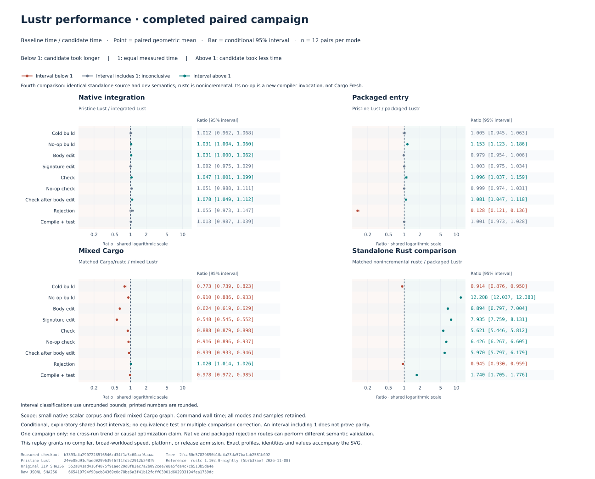

# Lustr performance: complete work and retained evidence

## Status on 17 November 2026

Lustr is **not yet a generally qualified, speed-preserving full-Rust compiler**.
Cargo build, edit, check and test latency is the main performance priority.
The latest completed mixed Cargo campaign is slower in eight of nine modes.
The supported native path has substantial warm gains over matching standalone
rustc on the small corpus, with slower cold compilation and rejection. Those
standalone results do not establish Cargo acceleration. Upstream Lust's headline
speedups remain measurements of its own sources and workloads.

The current [in-process symbol-check correction](docs/compiler-set/mixed-symbol-validation.md)
postdates these completed campaigns. Its component tests and timings do not
qualify a complete compiler or supply a new Cargo speed result. Fresh
source-built correctness and paired measurements are required.

The candidate also replaces mixed-object `objcopy` calls with
[validated in-process renaming](docs/compiler-set/mixed-symbol-rename.md) and
[enters the shared Cargo coordinator directly](docs/compiler-set/cargo-dispatch.md).
Those corrections preserve the existing compiler and Cargo contracts. No
component timing or removed process count is used as a whole-build speedup.

The latest retained fixed and project campaigns measure PR12 candidate
`5a3f4937d94e8f028dd85385ea65d51fcfe35a3b`, at actual merge checkout
`b3393a4a2907228516546cd34f1a5c60aaf6aaaa`. In
[source-built run 44111326777](https://github.com/glopyglerky/lustr/actions/runs/44111326777/job/134137398335),
the package passed target layouts, the unchanged failed-link negative control
and corrected recovery, mixed execution, retained checks with fresh Rust
metadata, mixed libraries, and all fifteen entry/runtime tests. The original
v2 profiling validation, expanded fixed benchmark and unchanged-project
campaign all passed. Eight non-macOS jobs succeeded; macOS compatibility was
cancelled without executing steps. This is not an all-platform pass.

The prior `40d2ac3` source-built job failed its separate profiling validation
when concurrent writes joined two trace records. Its paired measurements and
project campaign had passed independently. The [original failure and diagnostic
reconstruction](performance/2026-11-17-40d2ac3-profile.md) remain retained.
The corrected writer now has [successful original hosted profiling evidence](performance/2026-11-17-5a3f493-profile.md),
without changing the strict validator or repairing the new traces.

The separate [combined Linux native gate at `40d2ac3`](docs/compiler-set/measurements/2026-11-17-native-linux-40d2ac3/README.md)
failed after 5,527 ordinary differential passes: the sanitized repeat recorded
5,526 passes and one `unicode_props_hash` generated-program execution timeout
at its unchanged ten-second deadline. GCC linking had completed. Fuzz and
benchmark smoke were not reached. The [bounded diagnosis](docs/compiler-set/measurements/2026-11-17-unicode-sanitizer-diagnosis/README.md)
retains selected-source equality and a separate local LeakSanitizer tracing
failure; the hosted timeout's cause remains unresolved. Its exact native tree
is unchanged in `5a3f493`, whose [fresh full native CI](docs/compiler-set/measurements/2026-11-17-native-linux-5a3f493/README.md)
also failed after 5,527 ordinary passes and 5,526 sanitized passes, at the same
generated-program execution deadline. Its original ZIP and source-bound
manifest are retained separately. Source equality does not supply a passing gate.

Earlier complete native Linux gates at [dec0ce2](docs/compiler-set/measurements/2026-11-17-native-linux-dec0ce2/README.md)
and [74e14e7](docs/compiler-set/measurements/2026-11-17-native-linux-74e14e7/README.md)
remain attributed to their own sources and case sets. Default macro-corpus and
kernel checks are Rust/Cargo reference checks, not native coverage of those
whole corpora. Latest completed native macOS attempts were cancelled before execution;
earlier executed failures and their [portable fixture/Unix-address corrections](docs/compiler-set/native-differential-portability.md)
remain recorded. Cross-target layout checks do not establish native execution
on those operating systems.

## Which work is being compared?

| Workload | Reference and candidate | Evidence and boundary |
| --- | --- | --- |
| Fixed real Cargo graph | Matching Cargo/rustc → mixed Lustr | Real procedural macro, async code and a no_std/alloc dependency, with native objects and complete Rust compilation; explicit dev debug=0. |
| Actual unchanged coordinator package | Matching Cargo/rustc → primary Lustr entry | Five scenarios under normal dev/test defaults, including debug=2; outside native-object eligibility. Forced rebuilds change timestamps, not source bytes. |
| Historical unchanged Lust compiler project | Cargo/LLVM → explicit coordinator/Cranelift | November 8 whole-project builds with an older SDK and custom unwind-enabled backend; two measured pairs, no current mixed-compiler claim. |
| Supported native scalar corpus | Pristine Lust → integrated Lust | Preservation check for the declared native integration. |
| Same native corpus | Pristine Lust → packaged Lustr entry | Includes entry routing; rejection can add full-Rust validation. |
| Same native corpus | Matching standalone rustc → packaged native entry | Identical source and explicit dev semantics; rustc is nonincremental. First measured in schema 2 at `5a3f493`. |
| Larger native workspaces, broad edit families, startup/restart, isolated runtime and resources | Separate campaigns | Not established by these tables or a one-repetition CI smoke check. |

The fixed native corpus and Cargo graph are small. Older
[native product experiments](docs/compiler-set/measurements/2026-11-15-native-inference-v34/README.md)
have different architectures, producer-version confounds and retained limits.
They remain separate from current-entry measurements. The
[upstream audit](docs/compiler-set/upstream-benchmark-audit.md) maps Lust's
actual studies against this coverage.

## Latest fixed-corpus results

Twelve matched pairs per mode, Linux x86-64, candidate `5a3f493`. Times are
milliseconds. The ratio is the geometric mean of **baseline time divided by
candidate time**, with a conditional paired-bootstrap 95% interval. Below one
means the candidate took longer. It is not the ratio of the displayed medians.

### Mixed Cargo graph

Both lanes execute Cargo on the same source and dependency graph with the
matching SDK. The candidate can reuse checked scalar bodies and native objects;
the full Rust compiler still provides valid metadata and unsupported semantics.
The fixture's dev profile explicitly uses debug=0. It is neither a default-profile
large-project result nor a comparison with standalone Lust replacing real
Cargo dependency crates.

| Cargo workload | Cargo/rustc median | Mixed Lustr median | Ratio [95% interval] |
| --- | ---: | ---: | --- |
| Cold build | 151.860 | 206.257 | 0.773 [0.739, 0.823] |
| No-op build | 8.869 | 9.666 | 0.910 [0.886, 0.933] |
| Body edit | 48.793 | 78.386 | 0.624 [0.619, 0.629] |
| Signature edit | 51.841 | 94.646 | 0.548 [0.545, 0.552] |
| Check | 40.938 | 46.584 | 0.888 [0.879, 0.898] |
| No-op check | 8.779 | 9.723 | 0.916 [0.896, 0.937] |
| Check after body edit | 24.750 | 26.424 | 0.939 [0.933, 0.946] |
| Rejection | 34.027 | 33.405 | 1.020 [1.014, 1.026] |
| Compile plus test | 74.531 | 75.719 | 0.978 [0.972, 0.985] |

By the displayed medians, cold builds take approximately **36% longer**, body
edits **61% longer** and signature edits **83% longer**. Eight mixed modes are
slower; the rejection result does not establish an overall speed win. The
approximately 0.8 ms no-op gap does not account for the 30–43 ms edit gaps.

[All 36 comparisons and p95s](performance/2026-11-17-5a3f493.md),
[all 648 timed values](performance/2026-11-17-5a3f493.csv), and the
[vector chart with exact source data](performance/plots/2026-11-17-5a3f493/README.md)
are retained. No average across unrelated modes serves as a headline.



The seven campaigns' mixed cold/body/signature ratios are respectively
0.726/0.596/0.552, 0.662/0.581/0.558, 0.732/0.601/0.554,
0.717/0.614/0.553, 0.756/0.612/0.547, 0.743/0.622/0.558 and
0.773/0.624/0.548. Different source revisions and uncontrolled shared-host
conditions prevent a causal cross-run improvement claim. The earlier `afb17a8`
cold candidate outlier of 1,026.532 ms remains in its original samples; no
slower observation was excluded to obtain the published results.

## Actual project under its normal defaults

The [latest verified coordinator campaign](performance/projects/2026-11-17-5a3f493/README.md)
uses the unchanged actual `crates/lustr` package, its library, executables,
integration tests and existing fixture builds. Both lanes retain normal dev/test
profiles, debug=2, features and panic behavior. This profile falls outside
native-object eligibility; these results measure compatibility and overhead.

| Project scenario | Matched Rust median (ms) | Lustr median (ms) | Ratio [95% interval] |
| --- | ---: | ---: | --- |
| Clean dependency build | 536.577 | 537.211 | 0.9974 [0.9911, 1.0048] |
| Primed root build | 159.417 | 163.345 | 0.9775 [0.9653, 0.9900] |
| Primed root check | 61.293 | 63.611 | 0.9533 [0.9415, 0.9667] |
| No-op build | 10.062 | 11.098 | 0.9319 [0.9109, 0.9560] |
| Compile plus test | 5099.683 | 5191.029 | 0.9814 [0.9768, 0.9861] |

Four intervals favor matched Rust; clean build is inconclusive. Median overhead
is about 2.5% for primed root build, 3.8% for primed check, 10.3% for no-op and
1.8% for compile plus test. These descriptive percentages are calculated from
the displayed medians, without a pooled estimator. The
[preceding project campaign](performance/projects/2026-11-17-40d2ac3/README.md)
remains retained with its original values; differences do not establish a
causal optimization effect.

The forced build, check and compile-plus-test scenarios change only a source
timestamp. Source bytes stay unchanged. These are root rebuilds and do not
measure body/signature edits or demonstrate native acceleration. The project
has no registry dependencies.
Cold state clearing leaves OS page caches and dependency sources warm.
Each scenario contains twelve measured pairs after two excluded warmup pairs.
Both lanes pass initial/final executing tests and structured E0502 rejection
gates. The test gate reports 40 passed and nine existing explicitly ignored
tests. Source/tool guards, command contracts, Cargo fingerprints, owned state
transitions and observed successful daemon shutdown are required. Shutdown
receipts observe zero native child exits and do not claim native work.

Each original campaign contains 120 measured values plus warmups and gates.
The two campaigns retain **240 timings and ten comparisons**, separately from
the fixed-corpus totals. Their public projections contain every timing, pair
order, original stream hash, host snapshot and gate count. They do not expose
private original command streams or environments.

## Historical full-project Cargo acceleration with Cranelift

The [November 8 whole-project experiment at `42ab5dc`](docs/compiler-set/verification.md#qualified-full-project-result)
compiled the unchanged upstream Lust compiler's `lust` and `lust-core` binaries
through real Cargo. Both lanes used their project's default dev profile and
the same pinned `nightly-2026-11-05` SDK. The candidate explicitly selected
custom Cranelift revision `8edf4d040acb77048e04b52a379e93dccae888e6`, built with
its `unwinding` feature, while the reference used LLVM.

| Historical Cargo scenario | LLVM median | Cranelift median | Ratio of medians, LLVM / Cranelift |
| --- | ---: | ---: | ---: |
| Empty target directory | 59.536 s | 39.400 s | 1.511 |
| Warm, no source change | 19.532 ms | 21.149 ms | 0.924 |

There were only two measured pairs per scenario. The cold result represents
33.8% less median build time for that configuration; no-op builds were slower.
These descriptive ratios do not use the current paired geometric estimator and
have no confidence interval. The full build timings exclude runtime probes,
unit tests, verification and setup. Both lanes passed the same 391 unit tests
and runtime/rejection probes; the recorded compiler commands verify the backend.
The legacy project's pinned Cargo layout adjustment and test-only stack setting
were applied equally to both lanes and remain part of its qualification scope.

The [summary and identities](docs/compiler-set/evidence/lust-project-42ab5dc-summary.json),
[complete compressed report](docs/compiler-set/evidence/lust-project-42ab5dc.json.gz)
and [backend provenance](docs/compiler-set/evidence/lust-project-42ab5dc-backend.json)
retain the original evidence. This is an opt-in compatibility-coordinator path,
not the current mixed native compiler or an automatically selected backend.
Its rustc source `2d20b42b883dcfc014f3c2c56081eeb6091c2179` differs from the
current campaign SDK. The stock rustup Cranelift preview failed panic recovery;
the [matching custom backend requirement](crates/lustr/README.md#try-the-complementary-development-backend)
cannot be replaced by a panic flag or an arbitrary installed backend. Requalify
the complete current package and measure it before claiming a present Cargo gain.

## Native entry versus pristine Lust and matching rustc

This is the same completed `5a3f493` campaign and twelve matched pairs per mode
as the mixed Cargo table. Times are median milliseconds and ratios use the
paired geometric estimator, distinct from the historical Cranelift medians.

| Native workload | Pristine Lust median | Standalone rustc median | Lustr median | rustc / Lustr ratio [95% interval] |
| --- | ---: | ---: | ---: | --- |
| Cold build | 41.808 | 38.147 | 40.285 | 0.914 [0.876, 0.950] |
| No-op build | 3.542 | 37.982 | 3.106 | 12.208 [12.037, 12.383] |
| Body edit | 5.494 | 38.224 | 5.590 | 6.894 [6.797, 7.004] |
| Signature edit | 4.841 | 38.424 | 4.856 | 7.935 [7.759, 8.131] |
| Check | 2.217 | 11.619 | 2.069 | 5.621 [5.446, 5.812] |
| No-op check | 1.761 | 11.356 | 1.778 | 6.426 [6.267, 6.605] |
| Check after body edit | 2.051 | 11.285 | 1.882 | 5.970 [5.797, 6.179] |
| Rejection | 2.255 | 17.038 | 18.016 | 0.945 [0.930, 0.959] |
| Compile plus test | 30.535 | 53.267 | 30.960 | 1.740 [1.705, 1.776] |

Seven native comparisons favor Lustr over this standalone rustc configuration;
cold and rejection favor rustc. Body edits are 6.894× and signature edits
7.935× faster by the paired estimate. Native no-op is 12.208× faster, with
3.106 ms versus 37.982 ms medians. **Every rustc no-op starts a nonincremental
compiler invocation.** This is not Cargo's cached no-op or a comparison against
the fastest possible rustc configuration.

The [exact reference contract](docs/compiler-set/native-rustc-comparison.md)
uses identical supported source and edition 2024, target x86_64 Linux, opt-level
0, debug 0, unwind, overflow checks and debug assertions. Build emits a linked
program; check emits metadata. Rust compile-plus-test includes `rustc --test`,
actual execution with one test thread, and the adapter process's overhead.
Both child commands and exit/signal receipts are retained. Passing/failing
tests, invalid-source rejection, accepted runtime and recovery are required.

Against pristine Lust, packaged cold is inconclusive at 1.005 [0.945, 1.063],
body edit at 0.979 [0.954, 1.006], signature edit at 1.003 [0.975, 1.034], and
compile plus test at 1.001 [0.973, 1.028]. No-op favors Lustr at 1.153
[1.123, 1.186]. Check and check-after-body also favor Lustr on this corpus;
no-op check remains inconclusive. The separate pristine→integrated comparison
contains four intervals above one and five inconclusive intervals. An
inconclusive interval does not prove equivalence; classification uses
unrounded bounds.

Packaged rejection takes 18.016 ms versus pristine Lust's 2.255 ms:
0.128 [0.121, 0.136]. Against standalone rustc's 17.038 ms it is also slower,
0.945 [0.930, 0.959]. The entry may invoke full-Rust validation after native
rejection. Returning the first native error could incorrectly reject valid
full Rust. This is a complete user-visible negative path with differing
semantic work, not a claim about equivalent frontend phases.

## Exact source, retention and replay

All seven fixed campaigns use pristine Lust revision
`240e08d91d4aed0299639f6f11fd522912b248f9`, tree
`0ab1b09815802894e6078de0af59273cbdf46cb0`. The matching imported Rust SDK is
rustc 1.102.0-nightly, commit `5b7b37aefcb5b2fba3c2392bc9065b9e4602d494`,
commit date 2026-11-08, host x86_64-unknown-linux-gnu, LLVM 23.1.5.
The native correctness gate uses a separate Rust 1.99.0 oracle.

| Candidate / schema | Actual measured checkout | Repository tree | Host / profile availability |
| --- | --- | --- | --- |
| `c70eb1c` / 1 | `e7e9cf2a224b2590b895298439e5ede814c6229b` | `bf575b9343774b50646a78a5aa22eb52960de840` | Neither recorded |
| `afb17a8` / 1 | `bc5e0f9cd1168b6b064b9cda9a1455f4fc97d143` | `3ccebbefb604e0c45715200bcabc3b32b182d3ef` | Neither recorded |
| `048d824` / 1 | `fe4704ec6951b8c22c003476886602368810f637` | `5aec709fcd0df39004973a33320492ba82eb4fc1` | Neither recorded |
| `dec0ce2` / 1 | `dbacce1d14c8df60427eeca8dc7865156c98dcb4` | `c29f3bda282c0870c163303d865abb9be81bd066` | Host; completed v1 profile |
| `74e14e7` / 1 | `d0caf843d519763ae3b7bc8a3fdd1c26b12b307d` | `c15cdcb3481f2ee34651a8aa6c901d24df05ff8f` | Neither recorded |
| `40d2ac3` / 1 | `3b4b0bd67401085129d26be1afbd20e96c9b9d02` | `78318c4b01f8eb6f9518ea331efe69f0c457b1ce` | Host; failed v2 original, separate diagnostic reconstruction |
| `5a3f493` / 2 | `b3393a4a2907228516546cd34f1a5c60aaf6aaaa` | `2fca60e57829890b10a4a23da57bafab2581b092` | Host; completed original v2 profile |

The latest actual checkout is a GitHub merge commit whose tree equals its
recorded PR head. Its [incremental source bundle](performance/sources/2026-11-17-5a3f493/README.md)
preserves that exact object and declares both prerequisites. An isolated restore
reproduced the tree and all 13,443 source-entry names, modes and blob IDs.
That inventory check does not freshly hash every blob or recover the compiler
binaries. [campaigns.json](performance/campaigns.json) records every full head,
run/artifact ID and original/derived digest.

The latest [original qualification artifact](https://github.com/glopyglerky/lustr/actions/runs/44111326777/artifacts/14344840716)
has ZIP SHA-256
`552a841ad416f4075f91aec29d8f83ac7a2b092cee7e8a5fda4c7cb513b5da4e`;
its original raw JSONL SHA-256 is
`665419794f90acb84369c0d78be6a3f41b12fdff03001d602933194fea1759dc`.

Seven byte-identical original fixed-fixture ZIPs preserve **3,888 timed values,
198 comparisons and 12,768 command-output files** beyond Actions expiry. They
contain exact commands, exits, stdout/stderr, source/build receipts, component
hashes, correctness outputs, cache probes, host/profile records where collected,
and original failures. They do not contain every compiler binary. CSVs and
tables are derived projections. CI replays each archive and verifies exact
published table bytes; older artifacts are not overwritten.

Actual-project evidence has a separate publication boundary. Each campaign's
six public files and original public/encrypted ZIPs are retained byte for byte.
Authenticated recovery and source-bound reconciliation passed for **600 private
original files and 510 streams in each campaign**. The newest restored archive
contains 9,757,639 bytes across those files. The original private plaintext and
key remain private. Public CI checks file inventories, original ZIP digests,
ciphertext bindings, all 240 CSV rows and ten statistical comparisons.

[Recovery receipts](performance/projects/2026-11-17-5a3f493/recovery/result.json)
distinguish the locally rebuilt existing replay from the unavailable original
CI binaries. The recorded-source exporter reproduces public samples and README
byte for byte; other projection receipts agree semantically. Original compiler,
runtime, constructor and runner binaries are not freshly requalified. Exporter
runtime identity was not recorded by campaign version 1 and remains null.
Public replay does not perform another decryption or compiler execution.

## Work and statistical protocol

Compiler components use their manifest release profiles. Fixed-fixture
applications use dev opt-level 0, debug 0 and normal unwind/checks. The matched
SDK and identical paired inputs remain part of each recording. The actual
project keeps its separate normal debug=2 dev/test profile.

Schema 2 has four native lanes and two Cargo lanes, nine modes and twelve
measured observations per lane/mode: **648 timed commands and 36 summaries**.
Its original record contains 1,135 raw records, including 1,080 timed/untimed
commands and 2,160 output files. The six schema-1 campaigns remain five-lane,
540-command, 27-summary recordings, each with 938 raw records, 884 commands
and 1,768 outputs. Untimed priming, correctness, lockfile work and probes remain
in the archives without becoming timing samples. The different contrasts reuse
some measured lanes; the displayed comparisons are not independent experiments.

Native retention probes are separate untimed checks. A
`bodies-without-body-work` route requires zero relevant checked-body/codegen
counters; it does not mean zero total work. Earlier pristine traces still
performed collection, distinct from an explicit `reuse` route.

Cold trials use fresh per-pair Cargo target, intermediate, mixed, native and
XDG runtime cache directories. Native cold disables daemon/disk compiler
caches. OS page caches are not flushed. Warm trials retain each lane's native
daemon and caches. Matching standalone rustc remains nonincremental and starts
a compiler process on every request. A Cargo no-op may not invoke a compiler.
These are declared tool behaviors, not equivalent cache implementations.

The recorder uses randomized cyclic lane order, seed `327849038930`. Schema 2
accepts pair counts that are multiples of four from twelve through ninety-six,
so complete cyclic blocks cover all four native lanes. It measures command
wall time through observed child exit, with 100-microsecond polling. Tracing
and compiler statistics are disabled for measured commands. Runtime assertions
after ordinary builds are outside compile-only timing; compile-plus-test
includes actual execution. It is not an isolated runtime-throughput benchmark.

For matched times `(a_i, b_i)`, the estimate is
`exp(mean(log(a_i) - log(b_i)))`. The existing statistics implementation uses
10,000 paired bootstrap resamples, SplitMix64 with rejection-index sampling,
and percentile intervals. Sign-flip calculation is exact for the recorded
twelve-pair campaigns and through sixteen pairs; it is unavailable above
sixteen. The replay checks this existing implementation, not a replacement
estimator. The p95 is nearest rank; with twelve samples it equals the sample
maximum and is descriptive rather than a strong tail guarantee.

Intervals are exploratory and conditional on the workload and sampling setup.
Shared-host/cache effects can compromise bootstrap independence and sign-flip
exchangeability. There is no multiple-comparison correction or predeclared
equivalence margin. An interval containing one is inconclusive. An interval
excluding one does not establish universal performance or release admission.
Absolute observations, paired results and every slower sample remain visible.

## Reproduce the evidence

Fixed-fixture reporting uses Python 3.10 or newer and the standard library:

```sh
python3 tools/test-mixed-performance-report.py
python3 tools/check-mixed-performance-tables.py
python3 tools/check-mixed-performance-archives.py
python3 tools/report-mixed-performance.py \
  performance/archives/2026-11-17-5a3f493-qualification.zip \
  --output /absolute/new-report-directory
```

The output directory must not exist. Validation finishes before publication;
no recorded command arguments are executed. Outputs are `README.md`,
`timings.csv` and a fuller derived `samples.json` with identities and original
summaries. ZIP input binds its archive digest; an extracted directory cannot
claim a ZIP hash. All seven original CSV/Markdown reports replay byte for byte.

Verification covers completed status, raw digest, matching records, all output
sizes/hashes, source stability, identical paired inputs, exact schema-aware
coverage, unique sample IDs, expected exits, no timeout/signal, balanced order,
retention probes and statistical replay. Schema 2 additionally binds every
native compiler receipt to its declared executable. Its exact
source/operation/flag validation covers timed native commands and the new
reference gates, including the two-child rustc test receipts; that contract
does not extend to schema-1 records, Cargo argv or older untimed probe argv.
Under schema 2, altered flags, substituted executables, missing comparisons
and compiled-but-unexecuted tests fail verification.

All 42 reporting regressions passed. Archive/table replay covers 198 summaries,
3,888 timing values and 12,768 output files. These checks validate evidence;
they do not rerun the measured compilers. Original correctness gates supply
their separate executed evidence.

For public project replay, with the matching SDK installed:

```bash
cargo +nightly-2026-11-09 build --manifest-path crates/lustr-bench/Cargo.toml \
  --release --locked --example replay --target-dir target/project-replay
python3 tools/check-coordinator-performance-archives.py \
  --replay target/project-replay/release/examples/replay
```

Private recovery additionally requires the authorized recipient key, authenticated
decryption, archive verification before extraction, exact ordinary-file modes
and the recorded Git source. The [recovery procedure](docs/compiler-set/coordinator-performance.md)
and per-campaign receipts distinguish that operation from public replay.

To execute another actual campaign, use the exact source and
[source-built workflow](.github/workflows/compiler-set.yml) or
[build-and-qualify instructions](docs/compiler-set/mixed-compiler.md#build-and-qualify).
Build matching pristine, integrated and packaged components with the pinned
SDK/TinyCC, run every correctness prerequisite, then the existing recorder.
Keep all modes and original outcomes; a historical or unmatched package is
not a newly qualified candidate. Profiling runs separately from paired timing.
New completed artifacts receive new files and manifest entries.

## Host and measurement limits

The latest fixed campaign records Intel Xeon 6975P-C, four visible logical CPUs
and observed affinity 0–3, 16,464,297,984 bytes of physical memory, Linux
7.0.0-1014-aws and Ubuntu image 20261111.127.1. CPU quota, memory limit and
frequency governors are unreported. The project has its own before-campaign
snapshot from the same job. Only `dec0ce2`, `40d2ac3` and `5a3f493` have fixed
host snapshots; missing facts in the other four campaigns remain unknown.
Matching model/image descriptions do not establish controlled physical-host
or load equivalence between jobs.

The host collector binds its exact bytes and parsed facts to campaign identities.
These are observations: affinity is not pinned, physical memory is not a process
budget, and load/frequency can change. CPU time, RSS, aggregate process memory,
daemon growth, energy and isolated application runtime are unmeasured. Twelve
observations do not support broad tail-latency claims. Upstream Lust's reported
hardware and corpus facts are not substituted for Lustr's missing measurements.

## Phase attribution and the trace correction

The [new original v2 qualification](performance/2026-11-17-5a3f493-profile.md)
passed with 26 compiler profiles, 15 qualification commands and 35 successful
native responses containing measured emitter detail. Its 132 original input
files remain in the qualification ZIP. The original summary and Markdown
reproduce byte for byte, without reconstructing a trace or weakening validation.

Profiling is separate under `LUSTR_MIXED_PROFILE_DIR`; paired commands clear
their environments and do not inherit it. Spans can nest and compiler processes
can overlap. Summing spans does not produce command wall time. The following
values are instrumented observations, not additional paired speed samples.

| Instrumented duration (ms) | Body: one request | Signature: five requests summed |
| --- | ---: | ---: |
| Complete native request | 37.680779 | 176.700542 |
| Client request setup | 0.119698 | 0.377320 |
| Protocol exchange | 37.551081 | 176.282993 |
| Remote emitter | 35.257744 | 162.980178 |
| libtcc | 0.197719 | 2.016269 |
| Symbol-inspection process call (`nm`) | 34.545005 | 158.645402 |
| Native-object file synchronization | 0.409056 | 1.888154 |
| Directory synchronization | 0.009334 | 0.038698 |
| Exchange outside emitter, unattributed | 2.293337 | 13.302815 |

Remote emitter durations retain their own clock domain. The outside-emitter
residual includes transport, queueing, native frontend work before emission,
retained-state work afterward, guards and response production; it is not a
measured frontend phase. Signature values sum five requests and must not be
compared directly with the command's wall duration.

Across all 35 successful responses, the complete `nm` process-call span ranges
from 30.808 to 34.545 ms, median 31.857 ms. It includes lookup, launch, execution,
output capture and waiting. The actual child binary identity, emitted object
bytes and child CPU/spawn breakdown are absent. This is a dominant observed
span whose cause remains unresolved. Explaining that historical delay requires
same-runner tool and object identity plus spawn/wait attribution. The current
candidate removes this subprocess through checked in-process object validation;
its next measurement must profile the rebuilt Cargo route and time complete
commands. Undefined-symbol validation and durable object/certificate
synchronization remain required.

The [completed v1 profile](performance/2026-11-17-dec0ce2-profile.md) and the
[later failed v2 original with separate reconstruction](performance/2026-11-17-40d2ac3-profile.md)
keep their original status. The writer correction constructs a complete record
and holds the append-file lock through all writes. Its concurrent-process test
fails the predecessor and passes the correction; the new hosted profile now
validates that correction in the source-built toolchain. All 23 strict profiler
tests pass. Failed native responses keep their original diagnostic bytes so
the daemon's fresh/warm comparison preserves its meaning.

The [24-pair temporary-copy experiment](performance/components/2026-11-17-40d2ac3-link-input/review.md)
is a component result, outside compiler timing totals. Disposable copies omit
synchronization, while durable retained objects and certificates keep it.
The experiment neither measures a complete link nor establishes an additional
merge gain; the preceding candidate already omitted disposable-copy synchronization.

## Remaining performance work

The [upstream audit](docs/compiler-set/upstream-benchmark-audit.md) identifies
larger native workspaces, wider edit families, accepted/rejected recovery timing,
daemon startup/cached restart, release compilation, isolated application runtime
and CPU/memory studies. The direct same-source native/rustc comparison is now
measured. The unchanged coordinator adds real-project compatibility and overhead
coverage; its default profile does not establish large native acceleration.

The performance priority is complete Cargo work: cold builds, source body and
signature edits, checks and executing tests. First qualify and measure the
in-process symbol validator, in-process symbol renaming and shared direct Cargo
entry together against the existing matched Cargo baseline.
Then expand to unchanged projects with real source edits and observed native
participation, while retaining default-profile fallback and no-op overhead.
The full native sanitizer runtime failure and native macOS execution remain
separate correctness requirements.
An optimization must preserve checked Rust objects, retained native state,
real metadata, invalidation, diagnostics, panic behavior and complete work.
Retain its predecessor, exact sources, correctness results and all slower
observations, then rerun the complete paired campaign. Cross-run changes alone
do not isolate the optimization's effect.

The recovered [public upstream slice runner](docs/compiler-set/upstream-slice-benchmark.md)
adds supported-native scale, explicit incremental Cargo, no-op and generated
program execution scenarios. It uses upstream's pruned source and dependency
stand-ins. It does not measure source edits or run the mixed compiler through
Cargo, so a successful future result must retain that separate scope. No
completed slice measurements are added to the tables by recovering the runner.

Broader mixed coverage, representative workload speed and release admission
remain open. [Older work and the Darwin loader/lifetime investigation](docs/compiler-set/retained-work-disposition.md)
retain their own scope. Source identity, successful replay and a green
measurement step cannot substitute for those requirements.
