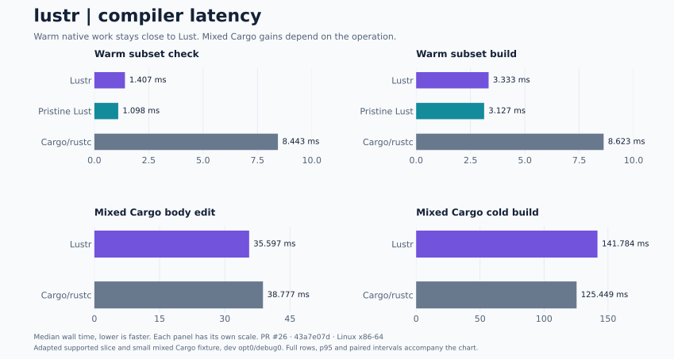

# Lustr

**One compiler: Lust for everything it supports, with imported upstream Rust
providing the complement inside the same compilation.**

Lustr aims to replace rustc while preserving Lust's fast frontend and incremental
compilation. An unchanged program can use both implementations. The compiler
uses resolved semantic facts before emission and shares the checked state,
dependencies and runtime contracts needed to compose their output.

The required product does not try the whole program with Lust and then retry it
with rustc. It does not require independently reimplementing the rest of Rust or
running an extra complete Rust frontend on every Lust-supported request.

## Start here

| Document | Purpose |
| --- | --- |
| [Architecture plan](docs/compiler-set/architecture-plan.md) | Fixed implementation contract, semantic ownership and the complementary subset. |
| [Completion checklist](docs/compiler-set/completion-checklist.md) | Exact remaining work, in dependency order, with completion criteria. |
| [Design checkpoint](docs/compiler-set/design.md) | What default and the reviewed candidate actually implement. |
| [Qualification checkpoint](docs/compiler-set/qualification-review-2026-11-18.md) | Source-bound correctness and CI results, including failures and newer work. |
| [Performance checkpoint](docs/compiler-set/performance-review-2026-11-18.md) | Measured gains, regressions, uncertainty, artifact links and practical tolerances. |
| [Contributor instructions](AGENTS.md) | Rules that keep subsequent work on this architecture. |

## Implementation status

**The general integrated compiler is unfinished.** The audited candidate has a
working scalar mixed bridge, genuine Rust artifacts and useful retained native
compilation. It still performs whole-crate Rust analysis on cold mixed requests,
then separately checks a native projection. Standalone entry still contains
whole-program retry. These are remaining implementation tasks, not the final
architecture.

The PR #31 documentation audit started from default `next` at
[`7cea76c9`](https://github.com/glopyglerky/lustr/tree/7cea76c9d3adc587b54ccff168fe07efafd40309),
which predates that mixed bridge. The architecture audit covers
[PR #29](https://github.com/glopyglerky/lustr/pull/29), head
`a9fd4c6336b1e39c4f584f7da50a437c5c248a0d`.
[PR #30](https://github.com/glopyglerky/lustr/pull/30) is a later callback-correctness
continuation. The qualification checkpoint identifies each tested source and
its remaining failures. That documentation publication did not merge either
implementation into default.

| Area | Audited PR #29 result | Remaining requirement |
| --- | --- | --- |
| Lust compilation | Native frontend and retained daemon preserved. | Use the full actual supported subset in mixed programs; the scalar bridge is smaller. |
| Mixed artifacts | Real native objects compose with genuine Rust metadata and libraries. | Share general semantic state, ABI/runtime ownership and dependencies across the boundary. |
| Linux native correctness | 5,528 ordinary and 5,528 sanitizer differential cases, 364 daemon scenarios, 1,200 fuzz edits passed. | Qualify the final changed candidate and reconcile the declared SDK's semantics. |
| Linux assembled mixed package | Real Cargo mixed execution, retained metadata, 17 public-entry tests and real I/O/link failure recovery passed. | Broaden coverage beyond the qualified scalar interface. |
| macOS native correctness | Ordinary and daemon gates passed; 47 differential cases failed on incompatible callback calls. | Qualify PR #30's proposed repair and complete the full native gate. |
| Unicode | A declared-SDK constant/runtime disagreement is documented. | Generate consistent version-bound semantics and reconcile all relevant differential failures. |
| Full replacement release | Not qualified. | Complete the architecture, correctness, exact package and performance conditions below. |

See the [qualification checkpoint](docs/compiler-set/qualification-review-2026-11-18.md)
for primary jobs, artifact identities and the later PR #30 failures. Passing
Cargo compatibility on a platform does not establish mixed native compilation
on that platform.

## Current candidate continuation

This reconciliation carries the corrected PR #31 contract onto the combined
implementation candidate. Its latest qualified native tree is
`7dbb7ac001f81c17adbbbd030573220dadfc079a`. The
[source-bound design continuation](docs/compiler-set/design.md#candidate-continuation--19-november-2026)
records the actual owning native prepare/emit boundary, scalar ABI and inline
module identity checks, and further correctness repairs. The general imported
semantic continuation and standalone retry removal remain unfinished.

The [correctness continuation](docs/compiler-set/correctness-continuation-2026-11-18.md)
repairs the native const/runtime Unicode disagreement with shared data from the
declared Rust SDK, verifies every Unicode scalar, and gives erased destructor
callbacks their actual required C signatures. The [partial-drop repair](docs/compiler-set/native-drop-semantics.md)
preserves remaining cleanup after partial moves and panics. The
[combined native qualification](docs/compiler-set/native-combined-qualification.md)
records 5,540 ordinary cases passing at `af0a281f2`, then all 65 unwind cases
passing through both native propagation and GCC exception tables after the
separately identified hash-table diagnostic correction. The original failures
remain recorded. These are Linux native results; fresh hosted sanitizer,
daemon, mixed-package and macOS qualification is still required.

The candidate also carries PR #27's distinct scanner-fixture name and restores
[PR #23's pinned macOS LLVM acquisition and SDK selection](docs/compiler-set/macos-toolchain.md).
All sanitizer probes remain required. The earlier process-directory ownership
repair is already present; it has not been implemented again.

The daemon starts directly and does not require systemd. Active source, build
rules, workflows, lockfiles and compiler loader graphs were audited; a CI guard
rejects service-manager dependencies. The
[native host runtime](docs/compiler-set/host-portability.md) documents the Linux
and Darwin adapters, source-built SDK receipts, focused tests and remaining
native macOS qualification. The primary native daemon is not yet a Windows
runtime; the independent Cargo coordinator remains the portable entry there.

The [qualification checkpoint](docs/compiler-set/qualification-review-2026-11-18.md#later-pr30-observation--19-november-2026-0502-utc)
also preserves the later successful source-built mixed job for initial PR #30.
It remains distinct from qualification of this newer candidate.

## Measured speed

The target is **close to Lust on supported work and near stock rustc on ordinary
complementary Rust**. Useful mixed-work gains matter; exact Lust parity and
large gains outside Lust's subset are not requirements. Correctness comes first.

These are existing PR #29 measurements, not timings of this documentation branch
or PR #30. Each comparison has 12 pairs. Ratios are paired geometric reference
time divided by Lustr time; they are not ratios of the marginal medians.

| Workload | Lustr median | Reference median | Paired speed ratio, 95% interval |
| --- | ---: | ---: | ---: |
| Native scalar body edit vs rustc | 7.550 ms | 69.714 ms | **8.228×** [7.043, 9.489] |
| Public warm check vs rustc | 2.963 ms | 13.127 ms | **4.616×** [3.695, 5.597] |
| Public warm build vs rustc | 7.705 ms | 13.143 ms | **1.990×** [1.427, 3.186] |
| Public warm build vs pristine Lust | 7.705 ms | 6.457 ms | 0.814× [0.625, 1.047] |

The warm-build difference in marginal medians is +1.249 ms, or +19.34%, versus
Lust. Near-Lust acceptance remains unresolved; the interval spans parity. The
ordinary full-Rust project's largest marginal-median overhead is +4.31%, with
wide paired uncertainty. Mixed cold build, check, check after a body edit and
signature edit all favor rustc in this campaign. Those losses remain visible in
the [complete performance checkpoint](docs/compiler-set/performance-review-2026-11-18.md).

The [existing engineering budgets](docs/compiler-set/practical-performance.md)
permit 10% or 0.5 ms added supported warm
latency, whichever is larger, and use 5% or 0.5 ms as the ordinary-Rust review
budget. They do not require every operation to beat rustc. The broad 12-pair
campaign is useful characterization; it is not the complete-package practical
assessor's qualified 24-pair acceptance result.

The [hosted dashboard](https://github.com/glopyglerky/lustr/actions/runs/44420439480/artifacts/14484151306)
retains all 29 rows. The performance checkpoint links original input artifacts,
source/tree hashes, profiles, uncertainty and replay details. No speedup from
upstream Lust or an earlier compiler-tuning experiment is transferred to the
complete product.

## What completes the product

The [completion checklist](docs/compiler-set/completion-checklist.md) requires:

1. One recorded integration baseline that preserves existing unique repairs.
2. The actual Lust capability and checked-state boundary, beyond isolated scalars.
3. Shared semantic ownership with imported Rust services, avoiding duplicated
   complete frontend work on the supported path.
4. Correct cross-boundary ABI, runtime, metadata and retained edit behavior.
5. Integrated standalone and Cargo entry without whole-program error-driven retry.
6. Version-matched correctness and exact package qualification on each advertised
   platform.
7. A finite practical performance assessment, clear source-bound README results,
   then publication of that qualified package.

A proposed optimization is useful when it removes an observed cost while
preserving these contracts. A few tenths of a millisecond alone do not justify
destabilizing compilation.

## Source and history

The pristine [Lust source](https://github.com/t3dotgg/lust-lang/tree/240e08d91d4aed0299639f6f11fd522912b248f9)
is pinned by [`upstream/lust.pin`](upstream/lust.pin). The imported Rust identity
is recorded in [`upstream/bluefe-core.pin`](upstream/bluefe-core.pin).
Explicit candidate integration patches retain their own identities and
qualification. [Upstream preservation](docs/compiler-set/upstream-lust.md)
requires provenance and meaningful evidence; necessary correctness repairs do
not have to make the compiler faster.

The root `src/` entry, native compiler, `lustr-native-core` and
`lustr-semantic` have different capabilities at different revisions. The
[design checkpoint](docs/compiler-set/design.md) gives the source-bound map.
The separate `crates/lustr` coordinator and earlier BlueFe releases remain
historical compatibility work. They do not complete this product.

The [previous default README](https://github.com/glopyglerky/lustr/blob/7cea76c9d3adc587b54ccff168fe07efafd40309/README.md)
preserves earlier preview commands, dependencies and measurements in their
original context. Original licenses, source history and evidence remain intact.

## Historical PR #26 measurements and qualification

The tables, chart and source records below retain the earlier PR #26 campaign
and its subsequent correction history. The PR #29 results above used a different
source and host. These records do not measure the 19 November candidate, and the
dated qualification checkpoint governs later job outcomes.



The earlier retained and replayed performance snapshot is **PR #26, `43a7e07d`**, tested as merge checkout
`8a7af2e1` with the same source tree. [All ten Compiler set jobs passed](https://github.com/glopyglerky/lustr/actions/runs/44337186349).
The results below were independently replayed from the original artifacts.
They are measurements of that exact source, not a claim for later changes.
They describe the current transitional paths; they do not establish completion
of the compiler architecture above.

All times are **median wall-clock milliseconds, lower is faster**. Ratios are
paired geometric means of Rust time divided by Lustr time, with conditional
95% bootstrap intervals. A ratio above one favors Lustr. Ratios are not computed
from rounded medians. Linux x86-64, Intel Xeon 6975P-C, matched pinned compiler
components, twelve measured pairs per mode. Profiles and reference commands
differ by family as stated below.

[Complete evidence and reproduction](performance/2026-11-18-43a7e07/README.md) ·
[All 29 three-compiler rows](performance/2026-11-18-43a7e07/dashboard/README.md) ·
[All 59 comparisons, p95 and intervals](performance/2026-11-18-43a7e07/comparisons.json) ·
[Raw timings](performance/2026-11-18-43a7e07/raw-timings.json) ·
[Earlier campaigns](PERFORMANCE.md)

### PR #26 public supported workload

This is the adapted/pruned upstream `goport-util-small` slice, with dev
opt0/debug0, unwind panic, overflow checks and debug assertions. The Rust
reference uses Cargo with incremental compilation. This is supported public
code, not an unchanged complete upstream application.

| Operation | Lustr ms | Pristine Lust ms | Rust reference ms | Rust / Lustr [95% interval] |
| --- | ---: | ---: | ---: | --- |
| Cold check | 153.014 | 126.273 | 248.260 | 1.630 [1.600, 1.662] |
| Warm check | 1.407 | 1.098 | 8.443 | 6.013 [5.759, 6.289] |
| Cold build | 282.161 | 255.076 | 337.885 | 1.210 [1.192, 1.233] |
| Warm build | 3.333 | 3.127 | 8.623 | 2.569 [2.447, 2.702] |
| Compile plus run | 4.047 | 3.767 | 9.053 | 2.249 [2.202, 2.302] |
| Program runtime | 0.876 | 0.872 | 0.713 | 0.806 [0.790, 0.821] |

Warm check is **6.013× faster than Cargo/rustc** and warm build **2.569× faster**
in this run. Their median overhead versus pristine Lust is **0.309 ms** and
**0.206 ms**, respectively. That is **28.2%** on the roughly 1 ms check and
**6.6%** on the roughly 3 ms build. Both fit the practical 0.5 ms warm overhead
budget by their medians. This does not establish exact statistical equivalence.

The [remaining entry-cost investigation](docs/compiler-set/remaining-entry-cost.md)
measured a **0.341 ms** median for the existing cache-enabled selector on a
separate host. Its input and toolchain validation accounts for much of the
earlier profile. This component measurement does not attribute the entire
public-command gap to selection. No further safe reduction was demonstrated,
so the required validation remains in place.

Program runtime is slower than the Rust-built executable. Compile plus run
still favors Lustr on this fixture. Compile latency and application execution
remain separate results.

### PR #26 ordinary full Rust under normal defaults

The unchanged `crates/lustr` coordinator project uses its original dev/test
settings, including **debug=2** and two Cargo jobs. Linked builds in that profile
use the full Rust implementation. These are compatibility/overhead measurements,
not native object acceleration. Forced root build/check/test cases change a
source timestamp; they are not source-edit benchmarks.

| Operation | Lustr ms | Rust reference ms | Rust / Lustr [95% interval] |
| --- | ---: | ---: | --- |
| Clean dependency build | 496.701 | 496.987 | 1.000 [0.997, 1.003] |
| Primed root build | 141.005 | 139.917 | 0.990 [0.978, 1.000] |
| Primed root check | 51.652 | 51.566 | 0.988 [0.973, 1.001] |
| No-op build | 8.954 | 8.862 | 0.957 [0.927, 0.988] |
| Compile plus test | 4608.873 | 4594.786 | 0.996 [0.994, 0.999] |

Median overhead ranges from **0.06% faster to 1.04% slower**. That fits the
near-stock performance goal for this project; it does not prove all Rust
projects or targets. Its initial and final executing tests passed in both lanes,
with **41 passed and nine existing explicit ignores**. The
[original project report](performance/2026-11-18-43a7e07/project/README.md)
retains every measured value, warmup and paired result.

A separate [single-file fallback check](docs/compiler-set/full-check-metadata.md#changed-path-timing)
does **not** meet that near-stock budget. With the metadata-output repair, its
median was **22.001 ms versus 15.465 ms** for matched rustc across 24 pairs on a
different Linux host. The paired median added latency was **6.755 ms**
[4.523, 9.117]. That command first receives a native refusal, then runs the full
compiler. The result includes both stages and does not isolate the new
temporary-output/process-management cost. This remains an open overhead case;
the Cargo project above is not a blanket result for every full Rust entry.

### PR #26 mixed Cargo work

This small real Cargo graph contains a procedural macro, async code and a
`no_std` dependency using `alloc`. It explicitly uses **dev debug=0**, which
allows eligible scalar functions to use Lust while Rust supplies metadata and
the remaining code. This is distinct from the normal-profile project above.
No matched pristine Lust Cargo lane was measured, so the full dashboard marks
that column **NT**, not zero or a guessed ratio.

| Operation | Lustr ms | Rust reference ms | Rust / Lustr [95% interval] |
| --- | ---: | ---: | --- |
| Cold build | 141.784 | 125.449 | 0.880 [0.870, 0.889] |
| No-op build | 8.551 | 8.103 | 0.951 [0.927, 0.975] |
| Body edit | 35.597 | 38.777 | 1.090 [1.076, 1.104] |
| Signature edit | 47.163 | 40.959 | 0.871 [0.862, 0.880] |
| Check | 34.728 | 31.495 | 0.901 [0.885, 0.915] |
| No-op check | 8.163 | 7.811 | 0.962 [0.951, 0.976] |
| Check after body edit | 19.829 | 19.284 | 0.968 [0.955, 0.980] |
| Invalid-code rejection | 25.470 | 27.110 | 1.058 [1.041, 1.073] |
| Compile plus test | 61.646 | 61.025 | 0.990 [0.984, 0.996] |

Body edits and rejection improve; **seven other modes are slower**. Cold builds
take 13.0% more median time, signature edits 15.1%, and checks 10.3%. These mixed
regressions remain open and must stay visible. Near-stock behavior on the
normal-profile project does not erase them, and changing an application's
profile to obtain a speedup is not an equivalent-workload comparison.

<details>
<summary>All supported native scalar measurements</summary>

This smaller native fixture compares the packaged entry with pristine Lust and
standalone rustc, using identical source and explicit opt0/debug0 settings.
Standalone rustc is nonincremental here; its no-op launches the compiler again.
Cargo's Fresh no-op belongs to the tables above and is not interchangeable.

| Operation | Lustr ms | Pristine Lust ms | Rust reference ms | Rust / Lustr [95% interval] |
| --- | ---: | ---: | ---: | --- |
| Cold build | 38.870 | 37.409 | 33.654 | 0.848 [0.821, 0.875] |
| No-op build | 2.824 | 2.949 | 30.864 | 10.939 [10.771, 11.109] |
| Body edit | 4.809 | 4.850 | 33.818 | 7.004 [6.690, 7.312] |
| Signature edit | 4.027 | 4.157 | 31.632 | 7.780 [7.543, 8.019] |
| Check | 1.604 | 1.630 | 8.750 | 5.485 [5.361, 5.621] |
| No-op check | 1.423 | 1.439 | 8.636 | 6.108 [5.918, 6.303] |
| Check after body edit | 1.520 | 1.433 | 8.530 | 5.630 [5.435, 5.860] |
| Invalid-code rejection | 14.457 | 1.615 | 13.477 | 0.943 [0.922, 0.966] |
| Compile plus test | 27.426 | 26.630 | 47.979 | 1.709 [1.641, 1.775] |

The native entry can invoke full Rust after native rejection, so rejection
latency includes that compatibility work. Cold compilation, edit behavior and
compile-plus-test are shown separately; no single aggregate hides regressions.

</details>

### Historical qualification and subsequent corrections

The measured Linux package passed all **16 public entry/runtime tests**,
including actual mixed Cargo compilation, build scripts, proc macros, metadata,
rejection, link-failure recovery, panic/drop behavior and executed `no_std`
WebAssembly. Full Rust comes from the identified pinned upstream implementation.
These executed cases do not prove every possible Rust program.

Continuation testing found and repaired a real single-file full Rust `check`
failure: rustc cannot atomically publish its metadata to `/dev/null`. The
[metadata-output repair](docs/compiler-set/full-check-metadata.md) uses a private
temporary directory, preserves compiler errors and signals, and cleans up after
the child exits. The new real regression fails on the original package and
passes with the corrected launcher. This focused result is separate from the
16-test completed snapshot above; the updated complete suite requires a new
source-built qualification run.

The corrected launcher also passed [seven upstream reproductions](docs/compiler-set/upstream-repro-correctness.md)
across 154 compiler/runtime commands, including full-Rust fallback, exact output
comparison, invalid-code rejection and restored native controls. Every invocation
was cold; the local environment denied Unix sockets, so this run does not qualify
daemon state transitions.

The continuation also [ports the narrow native main C type repair](docs/compiler-set/native-main-type-repair.md)
from [PR #24](https://github.com/glopyglerky/lustr/pull/24) onto the current native
tree. Its separately built native binaries passed ten ordinary/release-C cases
across 40 commands, matching Rust exit status and output. The original PR #26
package independently passed [five cold main-return cases](docs/compiler-set/main-return-smoke.md).
Those local checks remain separate from the later
[hosted qualification of PR #28](docs/compiler-set/hosted-qualification-2026-11-18.md),
head `429fe605`, tested with the identical merge source tree. On Linux, the
ordinary and sanitizer differential gates each passed **5,528 cases**, the
real-daemon suite passed **364 scenarios**, and the strict main-return transition
gate passed. The source-built mixed compiler and **17 full-entry contract tests**
also passed. These results qualify that source, not later changes.

The macOS jobs in that earlier campaign were cancelled before any steps ran.
They added no native platform evidence. Linux used GCC sanitizers; the later
PR #29 Clang function-type failures and PR #30 continuation are recorded in the
[dated qualification checkpoint](docs/compiler-set/qualification-review-2026-11-18.md). The primary daemon also has no
Windows host adapter. These correctness/platform release conditions are
independent of timing tolerance.

The complete-package before/after comparison originally stopped in a baseline
build-script layout test before timing. [The harness repair](docs/compiler-set/complete-native-warm-comparison.md#first-hosted-failure-and-harness-correction)
applies the same pinned Cargo setting already used by public lustr to both
packages' direct correctness tests. The first repaired run then exposed a
wrong-oracle comparison: 5,428 cases passed and 99 failed against the newer
package SDK. The corrected, separately verified Rust 1.99 oracle reduced that
to **5,526 passes and one failure**: the frozen native compiler reports Unicode
18 from its build toolchain while Rust 1.99 reports Unicode 17. That remaining
[Unicode semantic dependency](docs/compiler-set/unicode-semantics.md) blocks that
frozen source. A subsequent compiled witness found that native constant
evaluation returns `true, true` for two character predicates while the same
program returns `false, false` at runtime; the matching Rust SDK returns
`true, true` in both contexts. The current repair derives both paths from the
matching SDK and passes exhaustive local Unicode checks. The original frozen
comparison remains intact and has not produced admitted timings.

The separate warm-entry campaign correctly refused to compare different native
source trees. Neither campaign produced admitted timing samples. No causal speed
gain is assigned to PR #26's retained-check materialization change. The
[comparison disposition](docs/compiler-set/complete-native-warm-comparison.md)
preserves both failures and their exact source identities; the
[continuation PR](https://github.com/glopyglerky/lustr/pull/28) tracks the remaining
work.

Upstream Lust's default branch still matches the pinned `240e08d9` revision in
the November 18 audit. Existing upstream speed work is already included.
Upstream headline speedups belong to their own workloads; the tables here use
lustr's own source-bound results.

## Retained implementation and release history

<details>
<summary>Earlier integration experiments, preview commands, source map and measurements</summary>

This material is retained from the candidate before the PR #31 reconciliation.
Each experiment and preview keeps its linked source and qualification scope;
its present-tense descriptions refer to that recorded stage. These records do
not replace the governing plan, require independent Rust reimplementation, or
qualify the current candidate. General supported/complementary ownership remains
the work defined by the completion checklist above.

### Earlier compiler integration records


The required integration is defined by the [governing plan](docs/compiler-set/architecture-plan.md).
Import upstream Rust implementation for complementary work; preserve Lust's
supported frontend and retained execution. Upstream speed ratios are not
measurements of this integration.

The existing transitional candidate packages `lustr`, a Cargo-facing `rustc` entry, Lust,
Cargo and the full Rust compiler/runtime. Start with its
[commands and qualification](docs/compiler-set/native-preview-2026.11.15-1.md).
Full-language requests retain real Rust metadata and Cargo behavior. Requests
that Lust supports can compile through its native path. Further work must
qualify this combined journey and preserve the fast path.

Whole-target routing and successful stock compilation do not fulfill the
required architecture. The implementation must cover mixed work while retaining
Lust's supported frontend and body-edit acceleration.

The [mixed compiler experiment](docs/compiler-set/mixed-compiler.md) now builds
and runs one unchanged Cargo executable containing Lust-generated scalar code,
Rust-generated async code, a real procedural macro and a `no_std`/`alloc`
dependency. Its first qualified body edit reuses the retained Lust session and
checked Rust objects. Signature, macro and dependency changes invalidate that
reuse; invalid Rust is rejected. Ordinary Cargo checks can also reuse checked
scalar bodies in application and library targets while Rust writes fresh,
valid metadata for the edited source. General mixed-function coverage and equivalent
complete-work performance remain open.

The [source toolchain builder](tools/build-mixed-toolchain.rs) assembles the
complete local development toolchain from this checkout, the matching upstream
Rust SDK and TinyCC. It builds the lustr entry, Lust, native C ABI library,
Cargo integration and mixed driver without an older prebuilt lustr package.
See the [build instructions](docs/compiler-set/mixed-compiler.md#build-and-qualify).

The following native expansion experiments are retained research. Their
incomplete language and metadata coverage is not a requirement to replace the
imported full compiler before delivering lustr.

An experimental [native semantic artifact](docs/compiler-set/proofs/native-crates.md)
now binds checked structural signatures to their complete object and imports real
definitions before native resolver rewriting. Consumer-local IDs are remapped
from independent stable crate identities. The development qualifier executes
typed native calls and function values across independent producer and
consumer units, including separate-process 128-bit pointer-call ABI checks.
Callee evaluation preserves effects, borrow uses and the pointer read before
arguments. General metadata, Cargo and
full-language coverage remain open; the integration is unadmitted.
The experimental producer now uses the existing resolver and records inline
modules, visibility and re-export bindings. Native path/re-export/glob cases
execute with stock-oracle parity; general core/alloc and input records remain open.
Format sixteen retains bounded tuple, array, float and safe function-pointer
graphs with native layout, Copy, drop and effective C ABI checks. Large and
zero-sized returns use the existing backend rules. Compiler-generated memory
calls use Lust's upstream C memory unit and an exact licensed musl fill
dependency, localized within each object. This
retains an explicit C dependency and does not qualify a general no_std runtime.
It also records original native region signatures for shared and mutable
references to represented sized types. Independent borrowed calls and local
pointer coercions use the existing native region and loan rules. Region bounds,
erased-type agreement, escapes, aliasing and static restrictions are checked;
Borrowed callback exports retain the original pointer output-slot mask and
width, including static distinctions, and use the original pointer proof.
Unbounded named late-bound function lifetimes retain their exact original
region records. Written declarations must match the native names, count and
binding classification. Lifetime-only function bounds and early-bound parameters
retain independent declaration names and canonical original constraints. Imported
calls and pointer coercions use the original native region engine. Free item
regions and general nominal/type-generic region images remain open.

Sized references to slices and `str` retain their wide native layout and C ABI,
mutability, lifetime and represented slice element type. The image constructs
the original unsized referent type without assigning it a fabricated layout.
Original native checking, borrow rules and code generation handle these values.
This remains an experimental crate interface; real core, general unsized
aggregates, native Cargo and no_std runtime qualification remain open.

The experimental image also carries closed nongeneric struct and enum identities,
variant shapes, discriminants, fields and privacy. Pending shapes validate across all images before any
imported semantic definitions or signatures become visible. The unchanged
`Packet` case has native direct, pointer and independent-identity runtime
evidence. The unchanged array-backed nominal gate now executes large/nested
and borrowed consumers through explicit native runtime dependencies. Actual
original runtime and location providers validate before imported semantic
definitions. Independent producer and consumer panic locations match the
stock oracle. Tuple and unit constructors, enum imports and re-exports, tagged
and niche layouts, and cross-crate matching have native runtime evidence.
Empty enums, malformed records and consumer table remapping are also checked.
General nominal semantics, core/alloc and a complete no_std
runtime remain open.

The candidate also records lifetime-only nominal declarations and their original
kept field types, with separate applied lifetime arguments. It validates nested
applications and applied enum layouts before imported semantic publication.
Existing native variance, outlives and borrow checks consume fresh tables.
Reference cycles now retain stable nominal identities and complete lifetime
applications. Independent recursive and mutually recursive consumers pass runtime,
borrow rejection and malformed-image/remapping checks through the original native engine.
Separate symbolic nominal templates now preserve type and const parameter kinds,
combined parameter indexes, implicit Sized obligations and scalar, tuple and array
fields. Templates receive no invented layout or ABI. The original native
instantiation engine builds consumer instances, including types and const values
never instantiated by the producer. Independent struct/enum, array-length and
bool/char const cases have native runtime and rejection evidence. A focused
resolver interface reads collected parameter declarations when an imported item
has no local AST header, retaining the original const type and range checks.
General producer generic applications, lifetime-bearing template fields,
defaults, derives, Drop, general predicates and generic bodies remain open,
alongside borrowed nominal function-pointer images and complete crate support.

Full native Rust coverage is incomplete. Lustr now supplies bounded native
source-library additions and an opt-in native constraint-inference experiment.
Full frontend and crate/metadata expansion remain open.
The opt-in ABI also has an owned original-token frontend for bounded boolean
`unsafe` blocks, including initialized boolean locals with lexical scope and
shadowing checks. Direct safe Rust calls with boolean inputs and output have
separate native target, ABI and lexical-context checks before collection returns;
local function items, including `const fn`, in affected enclosing blocks use native item parsing,
arena integration and lexical item scopes;
see the [interface and limits](docs/compiler-set/proofs/native-unsafe-blocks.md).
`compiler/native` preserves the pristine reference pinned by
[`upstream/lust.pin`](upstream/lust.pin) plus an explicit integration diff.
Focused shared phase/state interfaces may use that diff;
imported Rust components retain separate identities. The guard binds reference,
patch, qualification record and integrated result under the
[source policy](docs/compiler-set/upstream-lust.md). Correctness, independent
review and appropriate performance evidence are required. No hidden overlay or
unexplained drift is admitted.
The root Cargo project now builds the native-first compiler entry candidate in
`src/`. Its [execution and artifact contracts](docs/compiler-set/native-driver.md)
identify the declared native integration, the C ABI cold entry and the inherited full
Rust core. Preview packaging does not establish a complete native compiler.
The separate compatibility coordinator remains in `crates/lustr`.
The experimental `native-inference` features in the root and native ABI crate
compile that unchanged coordinator through native Lust phases. They elaborate
bounded checked `OsString` and `PathBuf` conversion constraints in an owned AST clone, then
run full native checking and generation. The optional product worker uses a
separate inference library after ordinary native rejection. This is not enabled
in the published preview and does not supply general Rust metadata or Cargo
library artifacts; see the [entry contract](docs/compiler-set/native-driver.md).
An additional bounded ABI experiment reuses a validated successful executable
within one process. It discards inference state after each compile, recompiles
after semantic edits and retires on native runtime-source changes. Its host
file-input proof now covers the pinned Linux TinyCC header/linker path through
actual opens and identical-object replay. Its [fresh optimized measurements](docs/compiler-set/measurements/2026-11-15-native-host-inputs-v36/README.md)
retain substantial cold/edit regressions and a coordinator no-op slower than
stock Cargo. Runtime-loader closure and product integration remain open; this
is not a general build cache or native Cargo freshness implementation.
The owned original-token assertion formatter preserves nested source parentheses,
binary operators, bounded struct expressions, tuple fields, tuple/list-array
literals, array repeats and bounded const blocks,
and exact long panic payloads through full native rechecking.
Its [component51 qualification and measurements](docs/compiler-set/measurements/2026-11-15-native-array-repeat-v51/README.md)
cover direct and retained execution, edits, rejection, Drop and unwind; full
language coverage and full-project speed remain open. The const-block candidate
has separate [design and qualification obligations](docs/compiler-set/proofs/native-assert-text.md).
The [entry contract proofs](docs/compiler-set/proofs/native-entry-contracts.md)
cover target identity, bounded cancellation and copied-artifact publication;
their assumptions and performance limits are explicit.

Build the native compiler with an existing Rust bootstrap toolchain and the
pinned TinyCC assets. Keep generated output outside the source checkout:

```sh
LUST_TCC_HOME=/absolute/tcc CARGO_TARGET_DIR=/absolute/lustr-native-build \
  cargo build --manifest-path compiler/native/Cargo.toml --release --locked
/absolute/lustr-native-build/release/lust check unchanged.rs
/absolute/lustr-native-build/release/lust build unchanged.rs -o application
```

## Compiler entry candidate

The [native preview 2026.11.15-1 record](docs/compiler-set/native-preview-2026.11.15-1.md)
describes the packaged runtime, corresponding source, exact host dependencies,
executed checks and remaining coverage/performance requirements.

The assembled candidate provides `bin/lustr`, the rustc-compatible `bin/rustc`,
the declared integrated `bin/lust`/`bin/lust-core`, and the unchanged upstream full Rust core as
`bin/rustc-full`. Native examples use:

```sh
/absolute/candidate/bin/lustr build program.rs -o application
/absolute/candidate/bin/lustr check program.rs
/absolute/candidate/bin/lustr build src/main.rs --manifest-path Cargo.toml -o application
```

Full Cargo artifact requests can use the matched tools explicitly:

```sh
CARGO=/absolute/candidate/bin/cargo RUSTC=/absolute/candidate/bin/rustc \
  RUSTDOC=/absolute/candidate/bin/rustdoc /absolute/candidate/bin/cargo test --locked
```

These commands describe the candidate interface. Versioned previews record
their exact source, runtime, notices, host requirements and qualification.
Full Rust still uses the inherited Rust implementation. Native Rust library
metadata, general mixed-engine crate interoperability and full native expansion
remain unfinished. Working routing is not proof that those tasks are complete.

The Linux x86_64 GNU candidate adds executable/shared-library naming constants,
borrowed OS-string/path conversions to `PathBuf`, and `reserve`/`reserve_exact`
for `OsString` and `PathBuf`. These compile the original program through Lust with
an explicitly composed source library. Retained sessions verify the installed
source inventory and hashes and use a separate component identity. Explicit
source overrides stay cold. See the [entry contract](docs/compiler-set/native-driver.md)
for qualification and limits. The current host binary requires GLIBC 2.39,
libgcc and zlib, and the recorded `/usr/lib/ld-linux-x86-64.so.2` and
`/lib64/ld-linux-x86-64.so.2` loader paths. The payload was exercised on AerynOS
2026.08; its ELF report records each object's actual interpreter and dependencies.
Other native hosts are unqualified. Cold compilation and edits still regress
against stock Rust on the measured expansion fixtures.

## Historical compatibility toolchain

For versioned binary bundles, see [BlueFe releases](https://github.com/glopyglerky/blueFe/releases)
and [Lustr releases](https://github.com/glopyglerky/lustr/releases). Use a release's
recorded platform, component manifest and checksums. Keep the extracted toolchain
at a versioned absolute path; ordinary project builds do not rebuild the compiler.

[Preview 2026.11.09-2](https://github.com/glopyglerky/lustr/releases/tag/preview-2026.11.09-2)
is available for Linux x86_64 GNU with GLIBC 2.39 and GLIBCXX_3.4.32. Download all
six assets and verify `SHA256SUMS`. It includes the matched rustc-based BlueFe
compiler, host/Wasm libraries, Clippy/rustfmt and experimental unwind-enabled Cranelift.
Other hosts and Wasm execution are unqualified. The release records coordinator
source `07470b2`; the later default-branch benchmark/docs commit leaves that
coordinator source unchanged. See the
[exact release record](https://github.com/glopyglerky/blueFe/blob/main/docs/bluefe/releases/preview-2026.11.09-2.md).
It does not include native Lust. Its measurements do not measure native Lust
acceleration or establish full native Lustr coverage.

```sh
lustr --bluefe-root /absolute/toolchain build --workspace
lustr --bluefe-root /absolute/toolchain test --workspace
lustr --bluefe-root /absolute/toolchain build --target wasm32-unknown-unknown
lustr --bluefe-root /absolute/toolchain doctor
```

The older assembled BlueFe directory supplies Cargo, rustc, rustdoc and the produced
sysroot. In that historical coordinator, `lustr build` without a root
preserves the project's existing Cargo toolchain. Arguments, profiles, features,
compiler wrappers and failure status remain effective. Builds install nothing
and failed programs are never retried through another compiler.

An explicit Cranelift engine provides development code generation when a matching,
unwind-enabled backend has passed qualification. WebAssembly builds use
LLVM. A separately pinned backend cannot be loaded into a different BlueFe compiler.
The default forwarding path removes no compiler work by itself.

An experimental, explicit frontend job option applies to one selected Cargo
`rustc` target without replacing project flags or compiler wrappers:

```sh
lustr --bluefe-root /absolute/toolchain --frontend-jobs 4 \
  rustc --profile check -p your-package --lib
```

Select an actual package/target and a bounded CPU budget. More threads can regress
small targets or increase memory. The [argument-preservation proof and executable
checks](docs/compiler-set/proofs/frontend-scheduling.md) state the guarantees and
limits; measured speed claims require fixed-workload evidence.

Building the coordinator itself is optional contributor work:

```sh
cargo build --manifest-path crates/lustr/Cargo.toml --release --locked
cargo install --path crates/lustr --locked
```
## Source map

| Path | Responsibility |
| --- | --- |
| `src/`, `Cargo.toml`, `build.rs` | Primary compiler entry candidate, request contracts, native loading and full-core invocation. |
| `crates/lustr-native-core` | Owned C ABI entry around the declared native Lust integration; optional checked constraint elaboration and arena reindexing; compiled separately with PIC TinyCC. |
| `crates/lustr-native-core/src/{native_modules,expanded_parser,expanded_check}.rs` | Explicit opt-in module composition, original-token unsafe-block parsing and safety-qualified AST lowering; default pristine entry retained. |
| `crates/lustr-native-core/src/collect/safe_calls.rs` | Original-context native call resolution and bounded target, safety, ABI and signature qualification. |
| `crates/lustr-native-core/src/native_crate.rs`, `native_namespace.rs`, `native_types.rs`, `native_nominals.rs`, `native_generic_nominals.rs`, `native_regions.rs`, `native_runtime.rs`, `native_memory.rs`, `native_fill.rs`, `tools/native-crate-qualification.rs` | Experimental typed native artifact, concrete layout/ABI, symbolic nominal templates and original region records, explicit runtime/location dependencies, licensed memory providers, producer resolver projection and stable crate/definition/module remapping. Early imports and calls use no fabricated function ASTs. General metadata/Cargo integration remains open. |
| `tools/native-crate-adts-qualification.rs` | Native tuple/unit struct and enum producers, constructor/privacy/move/matching runtime and rejection cases, checksum-valid malformed variant/layout records and consumer remapping. |
| `tools/native-crate-borrowed-nominals-qualification.rs` | Lifetime-bearing nominal producer/consumer, kept-field/application completeness, applied-enum layouts, borrow rejection and malformed-image/remapping qualification. |
| `crates/lustr-native-core/src/native_consts.rs`, `tools/native-crate-consts-qualification.rs` | Experimental closed constant identities, typed values and promotion qualifiers through original native checking and fresh consumer constant tables; generic bodies and reference/allocation/function identities remain open. |
| `src/native_worker.rs`, `tests/native_inference.rs` | Opt-in inference child, direct native/oracle and product routing/failure qualification. |
| `crates/lustr-native-core/src/inference/{reuse,host_inputs}.rs`, `tools/native-{retained-probe,tcc-input-observer}.rs`, `tests/native_reuse.rs` | Bounded artifact proof, native host-input observation and edit/cold-oracle qualification; not selected by the product. |
| `library/lustr`, `library/lust` | Owned source-library additions and an explicit link to the guarded native component. Protected changes are recorded in the complete declared integration diff. |
| `compiler/native` | Pristine pinned Lust reference plus the declared reviewed integration diff; compiler, libraries, generation and differential fixtures. Focused shared interfaces follow the source policy. |
| `crates/lustr` | Transitional Cargo/rustc coordinator, BlueFe tool selection and compatibility qualification. |
| `upstream/lust.pin`, `upstream/bluefe-core.pin` and `tools/lust-upstream-check.rs` | Upstream source identity, exact compiler-component bindings and the Lust source-preservation guard. |
| `crates/lustr-semantic` | Optional version-pinned rustc inspection. It exports inspection data, not executable MIR. |
| `crates/lustr-bench` | Standalone paired benchmark runner and correctness gates. It is outside the coordinator workspace. |
| `examples/native_*` | Rust delivery, checksum-pinned notice collection and native measurement helpers; generated output belongs in an explicit build filesystem. |
| `docs/compiler-set` | Current design, decisions, divergence records, measured evidence and future work. |

The coordinator does not depend on TinyCC or registry packages. `cargo-lustr` and
`cargo-lust` remain command aliases. The native component has a separate Cargo
workspace so its C dependencies do not become prerequisites for installing the compatibility coordinator.

## Working contract and research

Native execution, workspace tests, doctests, invalid-borrow rejection and wasm
linking have dedicated BlueFe gates. Backend qualification also checks both
Rust ABI directions, ownership transfer and panic cleanup. Exact compiler heads,
source fingerprints, backend hashes and unsupported targets belong with results.

See the [integration and performance model](docs/compiler-set/bluefe-performance.md),
[verification record](docs/compiler-set/verification.md),
[design](docs/compiler-set/design.md), and [roadmap](docs/compiler-set/roadmap.md).
Performance claims are workload-specific. No-op, edit, rejection and executed-test
costs count alongside cold compilation. Slower candidates remain in the evidence.

The [measurement protocol](docs/compiler-set/benchmark-method.md) records exact
tools, dependency selection, compiler commands, correctness gates and every
paired sample. Its [mathematical analysis](docs/compiler-set/proofs/benchmark-analysis.md)
proves estimator invariants and conditional statistical properties. The
[metadata comparison proof](docs/compiler-set/proofs/metadata-compatibility.md)
states the one supported absent/null schema equivalence and its limits. These proofs
do not establish compiler equivalence or an unmeasured speedup. The runner's tiny
fixture qualifies the measurement machinery; public-repository campaigns remain
separate evidence.

The runner also supports [optional Linux CPU and peak-RSS observations](docs/compiler-set/proofs/benchmark-resources.md).
Fresh collectors preserve payload outcomes and avoid cumulative-peak leakage.
RSS means the largest waited process, so it cannot establish aggregate build
memory. The historical shared-v2 dataset remains wall-time-only. The matched pilot below
records CPU and scoped RSS; the collector itself removes no compiler work.

The [matched CGU16/ThinLTO pilot](docs/compiler-set/measurements/2026-11-09-cgu16-thinlto-v3/README.md)
completed 108 timed root checks plus nine excluded warmups. The optimized stage2
package used 17.9% less wall time than the matched no-PGO stage2 control across
the three fixed cases, with conditional candidate/control interval [0.7995, 0.8401].
It still used more time than stock Rust 1.99.1 on every workload. That secondary
comparison has unequal compiler/Cargo versions. The report includes every command
record, CPU and scoped RSS, regressions, independent review, a Rust replay and
[mathematical arguments](docs/compiler-set/proofs/cgu16-thinlto.md). These are
metadata-only checks, not full-build or application-speed results.

The [2026-11-09 public-repository dataset](docs/compiler-set/measurements/2026-11-09-shared-v2/README.md)
contains 72 timed root checks and nine excluded warmups. Explicit four-thread
BlueFe beat stock on t3code-ls, with a paired ratio of 1.268, but regressed by
point estimate on gitr and bluefin. One-thread BlueFe regressed on all three.
Same-compiler N1/N4 ratios were 2.345, 1.342 and 1.802. Unequal toolchain versions,
shared-host effects and fixed middle position for N1 limit interpretation;
runtime gates did not apply the timed frontend options. These are metadata-only
root checks, not default whole-build results. Full samples, conditional intervals,
regressions, scoped proofs and a Rust statistics replay command accompany the data.

For future campaigns, the runner now balances lane execution positions in cyclic
blocks. Its [position theorem and checks](docs/compiler-set/proofs/order-balance.md)
prove the count bound, without claiming to remove cache effects or establish a
speedup. Published historical measurements keep their original order and limits.

Backend campaigns can use the [routed test gate](docs/compiler-set/proofs/routed-test-gates.md)
with an explicit Lustr toolchain and engine. It checks the core tool selectors;
the native fixture observes LLVM and matching Cranelift compiler commands and
tests panic cleanup. Project-specific gates and matching backend artifacts are
still required before reporting performance.

## Fork ownership

Lustr owns this layout, its entry points and its documentation. Required inherited
compiler code is maintained as part of the native component. Upstream research
results describe their original revisions and workloads; they are not claims
about Lustr's current toolchain.

[Changes from upstream and retained dependencies](docs/compiler-set/divergences.md)
records why inherited components remain and how updates are qualified. The source
base is [Lust](https://github.com/t3dotgg/lust-lang) at
`240e08d91d4aed0299639f6f11fd522912b248f9`. Its original README and history remain
available there and in this repository's Git history. Licensing is preserved.

This is pre-alpha software. The coordinator forbids unsafe Rust in its own code.
The current native compiler, TinyCC, rustc, LLVM and platform dependencies still
require review and eventual migration before a whole-toolchain memory-safety
claim is justified.

</details>
