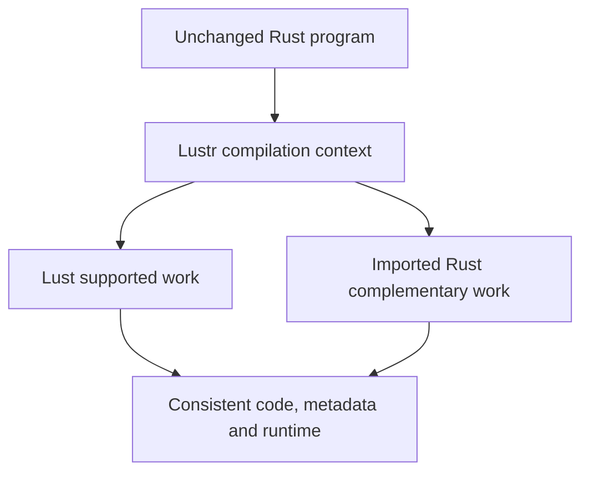

# Lustr compiler design

Follow [the governing architecture plan](architecture-plan.md). This is the
required design, not a claim that the current candidate already implements it.
Lustr owns the compilation. Lust handles its supported work; imported upstream
Rust implementation supplies the complement through a shared compiler boundary.

## Required composition

The diagram describes work inside the intended compiler. The compilation
context must expose real capability and semantic contracts; it is not a
standalone selector that runs Lust to see whether it fails. Mixed programs
must retain Lust participation for their supported work.

The boundary must preserve Lust's native frontend and retained body-edit path.
A design that always performs complete rustc analysis before admitting any
Lust work does not satisfy the required fast path. Using Lust for later code
generation alone does not establish preservation of its frontend behavior.

## Semantic ownership

A shared compilation request needs consistent definition and instance
identities, macro expansion, name resolution, types, trait obligations, layouts,
calling conventions, symbols, drops, unwinding, metadata and dependency reads.
Reuse existing compiler facts. Do not invent substitute layouts, empty metadata,
or source-keyword classifications.

The next implementation must specify which existing component owns each fact,
when it is computed and how the other implementation consumes it. Imported
upstream Rust services are allowed where needed. This does not require a new
independent implementation of every missing Rust feature, and it does not make
whole-program stock-rustc retry an acceptable endpoint.

Capabilities must be explicit before generation. Keep three situations distinct:

- Work admitted to Lust under its actual semantic and runtime contracts.
- Valid Rust requiring the complementary implementation or shared services.
- Invalid Rust or an implementation failure that must remain a reported failure.

An admitted emitter failing is not an ordinary capability classification.
Object and relocation validation remain necessary after emission; a malformed
object must not silently cause a second compiler to produce a successful build.

## Existing pieces to reuse

| Piece | Existing source | Current limit |
| --- | --- | --- |
| Retained native frontend and code generation | `compiler/native/src/driver/` | Public request interface exposes compilation status, not a complete retained admission/continuation boundary. |
| Observed checked native state | Native phase observer and semantic-image experiments | Observation and bounded artifact interfaces do not establish general cross-implementation ownership. |
| Rust binding and ABI queries | `crates/lustr-semantic/src/mixed_main.rs` | Current mixed selection is limited to represented nongeneric scalar functions after Rust analysis. |
| Real native objects and symbol closure | `crates/lustr-native-core/src/mixed_unit.rs` and symbol readers | Some current admission checks still happen during or after attempted native generation. |
| Complementary object and metadata production | `crates/lustr-semantic/src/mixed_backend.rs` | Actual composition exists, but does not cover Lust's entire supported subset or remove duplicate cold frontend work. |
| Cargo graph and artifacts | Existing Cargo integration | Supporting infrastructure; a coordinator is not the target compiler. |

A retained prepare/emit seam may help expose the missing boundary. It must keep
the same checked state, interfaces and dependency reads into emission. It is an
intermediate implementation step, not a license to introduce a fresh language
selector or send mixed programs through whole-program retry.

## Public entry and Cargo

The intended public entry is Lustr, with rustc-compatible requests and genuine
Cargo artifacts. Cargo remains responsible for its dependency graph, feature
selection, build scripts, procedural macros and scheduling. Supporting argument
adapters may preserve those interfaces without becoming a second architecture.

The current standalone native-first retry and current Cargo mixed path are
separate transitional implementations. Their actual behavior is documented in
[the plan's source audit](architecture-plan.md#what-exists-today). Do not describe
all Cargo commands as trying Lust first; do not describe successful forwarding
to the packaged compiler as completion of the integrated boundary.

## Reuse and performance

Keep Lust's recorded dependencies, retained frontend and body-edit behavior.
Reuse complementary work only when its complete semantic inputs remain valid.
Changes to signatures, types, traits, macros, dependencies, target or profile
must invalidate affected work. Preserve diagnostics, side effects, panic/drop
behavior and real metadata when deciding what can be reused.

Measure supported, complementary and mixed work separately, including complete
user-command latency. Near-Lust supported performance and near-stock ordinary
Rust are the goals; exact parity and large gains outside Lust's subset are not
required. [The practical budgets](practical-performance.md) do not waive the
architecture or correctness requirements.

## Acceptance

[The roadmap](roadmap.md) gives the implementation order and evidence required.
The deliverable is complete only when the actual integrated compiler meets the
capability, mixed-work, artifact, correctness and performance conditions. A
module rename, coordinator, failure-driven fallback or a few scalar fixtures
cannot establish that result.

The [previous design text](design-history-before-2026-11-18.md) is archived for
provenance. Its earlier prohibitions on imported Rust implementation and its
transitional compatibility direction are not current instructions. The current
contract neither bans importing Rust nor permits substituting a stock-compiler
wrapper for the requested integrated compiler.
