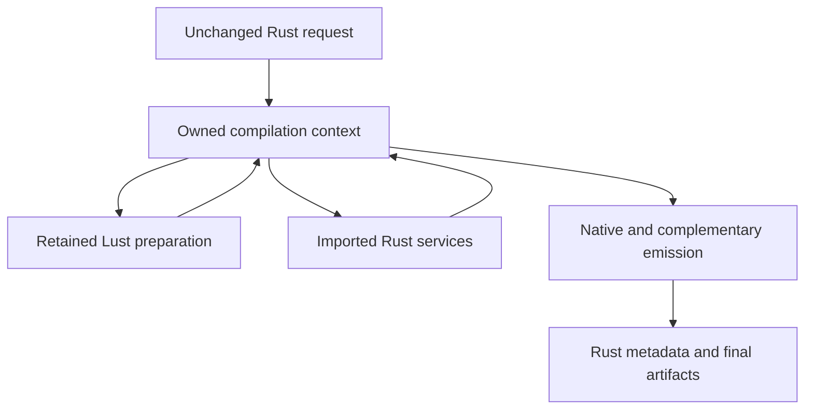

# Lustr compiler design

The [governing plan](architecture-plan.md) and [compiler contract](native-contract.md)
define the required architecture. This document specifies responsibilities and
interfaces that implementation must satisfy. It is not a claim that these
interfaces are already complete. Status and evidence belong in the
[completion checklist](completion-checklist.md) and
[qualification review](qualification-review-2026-11-18.md).

## Compilation ownership

Lustr owns the unchanged program, its semantic context, unit assignments,
retained dependencies, diagnostics, and artifact publication. Lust keeps its
frontend and retained worker for supported work. Imported upstream Rust services
supply missing shared facts and complementary implementation.

The context holds compiler state and dependency relationships. It is not a
separate source-language selector. The two implementations may inspect shared
facts, but each semantic result and emitted instance needs an authoritative
owner. A general invalidation or unsupported capability may require new work
inside the same invocation; an executed compiler failure cannot authorize a
second whole-program attempt.

## Semantic responsibilities

| Responsibility | Required ownership | Existing work to reuse |
| --- | --- | --- |
| Source, definitions, expansion, hygiene, and bindings | One identity model and source mapping across the compilation; imported services may supply missing resolution/expansion behavior | Native `Program` and resolver state; pinned Rust AST/HIR/definition queries |
| Body checking, types, obligations, and constants | Lust owns its supported checking; requested upstream services supply missing facts without unconditional duplicate checking | Native checked/lowered state and read sets; upstream type, trait, const, and borrow queries |
| Layouts, calling conventions, and generic instances | Explicit agreement for each represented boundary and target; a matching size or source signature is insufficient | Candidate Rust `FnAbi` comparisons, native ABI queries, instance and symbol identities |
| Runtime requirements | Explicit allocation, ownership, drop, panic/unwind, thread-local, and standard-library contracts for interacting values | Native runtime and upstream implementations with source-bound qualification |
| Code generation | One owner for each admitted definition or instance; backend outputs compose through validated symbols and objects | Candidate native object validation and LLVM codegen-unit filtering |
| Metadata, archives, dep-info, and linking | Genuine Rust machinery consumes valid semantic facts and actual object inventory | Candidate upstream metadata encoding, distinct native rlib members, and original linker |
| Retained work | Inputs and identities determine validity; edits invalidate consumers across both implementations | Native dependency reads and candidate HIR/dependency certificates |

Importing a service includes the dependencies necessary to use it correctly.
The full upstream source graph is allowed. Dependency count, binary names, or
process count do not establish whether the architecture satisfies the contract.
The execution trace must show that a complete extra frontend is not imposed on
every supported request.

Upstream services can need crate-wide context for resolution, coherence, macros,
or metadata. The implementation must explain how that context is shared or
retained. Calling the unmodified whole Rust analysis pipeline before every
native decision does not answer that ownership problem. Rebuilding all missing
Rust semantics independently is also not required.

## Required internal interfaces

These are interface obligations for the next implementation. Names below denote
roles; they are not declarations of an existing API or a separate planner.

| Interface | Consumes | Produces | Required invariant |
| --- | --- | --- | --- |
| Prepare a unit | Owned compilation context, stable unit/instance identity, requested target/profile, current dependencies | Admitted native state, a complementary-work requirement, invalid-Rust diagnostics, or implementation failure | Capability is established before emission from actual semantics; preserve the work already performed |
| Request a shared upstream fact | Retained context, a resolved query and its inputs | An authoritative semantic result and its dependencies, or a diagnostic/failure | Do not restart an independent whole-program compilation to obtain the result |
| Emit native work | The admitted native state and its represented runtime/ABI obligations | A validated native object and symbol inventory, or failure | Consume the same prepared state; do not parse/check the unit again or fall back after emission fails |
| Complete complementary work | The shared context and explicit unresolved work | Checked complementary results and objects, or diagnostics/failure | Keep already admitted Lust work on Lust and use the same identities and semantics |
| Publish the result | Validated objects, genuine metadata, dependency information, and complete successful compilation state | User artifacts and a committed retained-state record | A failed object, link, sync, or publication cannot become a cache miss that hides the error |

The preparation result has four meanings:

- `NativePrepared` retains the actual checked/lowered state, definition and
  instance identities, source mapping, dependency reads, and represented ABI
  and runtime obligations. A later emitter consumes this preparation once.
- `RustComplement` identifies missing capability or a required shared service.
  It continues the same request. It does not assert that source awaiting the
  imported checks is valid Rust.
- `InvalidRust` carries authoritative diagnostics. A missing native feature
  must not be mislabeled as invalid Rust merely because the native checker
  cannot process it.
- `Failure` carries a compiler, invariant, transport, emitter, object, or linker
  error. It cannot be converted into complementary work after the fact.

Within one process, retained values can borrow their actual semantic owner.
Across a worker boundary, use owned serialized facts or generation-bound handles
with explicit lifetimes. Process-local pointers and local IDs cannot become
persistent semantic identities. Bind request and response identities and reject
unknown or inconsistent outcomes. Once a request may have executed, ambiguous
transport failure cannot trigger a hidden replay.

Post-emission object and relocation validation remains mandatory. Its failure is
an artifact failure, not evidence that native capability was absent. Separate
admission from validation without weakening either.

## Preserve the native worker and fast path

The native worker already owns useful parser, resolver, checker, lowering,
code-generation, and dependency state. Extend its preparation/continuation
boundary rather than replacing it with complete Rust analysis followed by
native code generation. Keep unchanged and body-edit shortcuts when their
recorded inputs remain valid.

A fully supported cold request must demonstrate native preparation without a
complete second frontend. A mixed request must share required facts and import
complementary work while preserving native participation. Actual phase evidence
must distinguish these cases; a successful binary or an engine label is not
sufficient.

Shared services and retained results do not waive validation. Signature, type,
trait, macro, dependency, target, profile, and build-script changes can affect
previously accepted native bodies. Missing input observations require
recomputation within the owned compilation. Differential qualification must
compare cold and retained results without replacing the user's failed request
with a successful retry.

## Current implementation and the missing continuation

The default at
[`7cea76c9`](https://github.com/glopyglerky/lustr/commit/7cea76c9d3adc587b54ccff168fe07efafd40309)
has a native-first entry and optional Rust semantic inspection. It does not have
the later scalar mixed driver. Do not treat the candidate files below as present
in the default merely because this plan links them.

The architecture-audited PR29 snapshot is
[`a9fd4c6336b1e39c4f584f7da50a437c5c248a0d`](https://github.com/glopyglerky/lustr/commit/a9fd4c6336b1e39c4f584f7da50a437c5c248a0d).
It supplies concrete components:

| Candidate source | Implemented behavior | Remaining limit |
| --- | --- | --- |
| [`driver/mod.rs`](https://github.com/glopyglerky/lustr/blob/a9fd4c6336b1e39c4f584f7da50a437c5c248a0d/compiler/native/src/driver/mod.rs) | Borrowed observation of actual native phases and typed mixed-response validation | Observation is not general semantic ownership transfer |
| [`mixed_unit.rs`](https://github.com/glopyglerky/lustr/blob/a9fd4c6336b1e39c4f584f7da50a437c5c248a0d/crates/lustr-native-core/src/mixed_unit.rs) | Private non-cloneable `PreparedMixed` admits represented scalar IR before C generation and is consumed by emission | No general runtime, aggregate, call, or full Lust-subset boundary |
| [`mixed_main.rs`](https://github.com/glopyglerky/lustr/blob/a9fd4c6336b1e39c4f584f7da50a437c5c248a0d/crates/lustr-semantic/src/mixed_main.rs) | Real HIR bindings, primitive method identities, Rust/C ABI checks, and strict native outcomes | Cold selection follows whole-crate Rust analysis, then Lust parses/checks an isolated source projection |
| [`mixed_backend.rs`](https://github.com/glopyglerky/lustr/blob/a9fd4c6336b1e39c4f584f7da50a437c5c248a0d/crates/lustr-semantic/src/mixed_backend.rs) and [`mixed_objects.rs`](https://github.com/glopyglerky/lustr/blob/a9fd4c6336b1e39c4f584f7da50a437c5c248a0d/crates/lustr-semantic/src/mixed_objects.rs) | Native definitions are omitted from LLVM only after successful native emission; genuine Rust metadata and objects compose | Rust still owns whole-crate semantic decisions; broader layouts/runtime contracts are absent |
| [`mixed_cache.rs`](https://github.com/glopyglerky/lustr/blob/a9fd4c6336b1e39c4f584f7da50a437c5c248a0d/crates/lustr-semantic/src/mixed_cache.rs) | Fresh expansion, actual HIR/dependency identities, schema-5 certificates, and fatal post-admission errors | General edits exceed the unchanged or narrowly certified literal-edit boundary |
| [`src/main.rs`](https://github.com/glopyglerky/lustr/blob/a9fd4c6336b1e39c4f584f7da50a437c5c248a0d/src/main.rs) | Public native entry and preserved compatibility tools | Standalone status-1 and diagnostic-driven retry remains |

The candidate's bridge has stronger correctness boundaries than the default,
but it does not carry arbitrary original Rust item meanings into Lust. Its
source projection is safe only under its bounded checks. Extending it requires
shared definitions and semantics, not copying larger body strings or adding
more keyword exclusions.

PR30 at
[`b94d3713616804fead3f30b18a530e2e81a9510b`](https://github.com/glopyglerky/lustr/commit/b94d3713616804fead3f30b18a530e2e81a9510b)
continues correctness work without adding the missing general boundary. Its
proposed callback repair and exhaustive arithmetic checks require their own
exact-source validation.
Read the qualification review for current results and failures.

## Candidate continuation — 19 November 2026

This documentation reconciliation starts from implementation candidate
`af0a281f2d1fae04e8ebfd5aa2c4872b20245c04`, complete tree
`371768e6e12308f73acb2e7242925541bf96d6a7`, native tree
`a3f37f8a4d2364757a3bebf476e530e6ddf4735a`. It carries PR #31's corrected
contract forward; it does not change the product destination or transfer earlier
qualification to this source.

| Implemented continuation | Source-bound record | Remaining boundary |
| --- | --- | --- |
| Ordinary native preparation now owns the actual checked `Program`, lowered bodies, local type arenas, source snapshot and dependency reads until emission. Abandoned preparation preserves the previous output; cold and retained tests cover invalid input, real link failure and recovery. | [Checked-request ownership](checked-request-ownership.md) | This does not yet suspend unsupported native queries for imported services or remove the standalone retry. |
| Scalar mixed admission checks actual Rust/C `FnAbi`; source-spelling checks, inline-module identities and schema-6 retained certificates guard projection and reuse. | [Mixed scalar and module qualification](mixed-integer-modules.md) | General aggregate, call, runtime and cross-implementation semantic ownership remain open; the native identifier-normalization gap is separate. |
| Shared pinned Unicode data, erased callback signatures and declared-SDK standard-library repairs are present, with preserved red witnesses and scoped qualification. | [Correctness continuation](correctness-continuation-2026-11-18.md), [Unicode semantics](unicode-semantics.md), [partial-drop semantics](native-drop-semantics.md) | Component evidence does not qualify the whole changed package or all programs. Full applicable native, sanitizer, mixed and platform gates remain separate. |
| The distinct scanner fixture name from PR #27 is carried into the candidate; the existing process-directory ownership repair is retained. | `compiler/native/tools/lust-port/tests/scan_fixture.rs`; `crates/lustr/tests/process.rs` | Source guards and final qualification must bind the complete integrated source. |
| The daemon starts directly, with an active-source service-manager dependency guard and documented host adapters. | [Host portability](host-portability.md) | This does not supply the missing integrated Mach-O bridge or native Windows daemon. |

No new performance result is claimed for this candidate. The PR #26 README
measurements and PR #29 [performance checkpoint](performance-review-2026-11-18.md)
retain their original sources and hosts. The numbered completion criteria stay
in the [single checklist](completion-checklist.md).

## Boundary acceptance

Implement in the order given by the [plan](architecture-plan.md#implementation-order-and-acceptance).
Each step must include an unchanged executable example and invalid-input or
failure controls relevant to the boundary. Required evidence includes:

- Fully supported work preserves Lust preparation and retention without a
  complete extra Rust frontend.
- Mixed work executes native and imported implementations through one shared
  context, with source/instance identities and actual phase participation.
- Cross-boundary data, calls, drops, unwinding, and allocation preserve the
  declared Rust semantics and requested configuration.
- Real rlib/rmeta, dep-info, archives, and dependent Cargo crates work through
  upstream metadata machinery with no fabricated placeholders.
- Edits invalidate affected facts across both implementations, and failed work
  leaves prior successful retained state intact.
- The public path uses this boundary automatically, without ordinary
  compile/fail/retry or a separate source-language selector.

Retain the existing native differential gates and source-preservation discipline.
Unicode semantic identity and sanitizer failures are correctness obligations
before affected capabilities are admitted. They cannot be repaired through a
version string, suppressed diagnostic, changed panic setting, or easier test
profile.

Performance qualification follows correctness and actual architecture coverage.
Keep complete-command latency, native worker time, complementary work, linking,
and generated-program runtime distinguishable. Practical tolerances permit
small overhead; they do not authorize changing the design or hiding regressions.

The previous design remains available at its
[immutable pre-plan source](https://github.com/glopyglerky/lustr/blob/7cea76c9d3adc587b54ccff168fe07efafd40309/docs/compiler-set/design.md).
Its requirement for independent native expansion of every gap and faster results
for every necessary modification is superseded by this contract.
